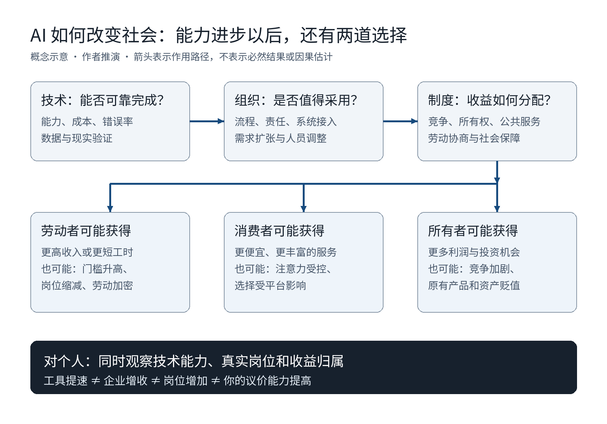

# 2026—2036：AI、实体经济与社会重构——未来十年的个人选择

> 研究截至 2026 年 10 月 30 日。面向希望理解 AI、工作与产业变化，并作出长期选择的读者。本文以中国就业与生活环境为主要决策语境，使用海外研究时保留外推限制。
>
> 阅读约定：**事实**指实际查阅的研究、数据或政策；**推演**指基于机制的条件判断；**建议**是作者对行动的取舍。预测年份是规划窗口，不是技术到来的时间承诺。

## 一、先给判断：未来十年，最值得争取的是参与重要问题的资格

我的基准判断是：未来十年，AI 会使许多可数字化任务的执行成本下降，推动工作、组织与服务重新组合；但变化会很不均匀。某些行业可能迅速重组，某些机构可能多年停留在试点。高质量服务可能变得更便宜，人的收入、闲暇和自主性却未必同步增加。

因此，个人不宜把未来押在两个极端上：一边相信“照着上一代的职业阶梯往上走就够了”，另一边相信“反正 AI 即将接管一切，现在学什么都没用”。两者都回避了眼前真正需要做的选择。

我主张的方向是：**让自己能够进入真实问题，形成可检验的判断，交付有用的结果，并逐渐分享成果。** 其中既有能力，也有进入组织、接触用户和获得信任的机会；既需要收入，也需要保留改变方向的余地。

这不意味着人人都要当老板。优秀员工、研究者、工程负责人、专业服务者和创业者，都可能拥有不同程度的自主权。职业头衔不能替代对实际工作内容和收益结构的判断。

全文有七个核心结论：

1. **目前更可信的风险是职业入口和任务结构变化，而不是已经发生全民失业。** 新人可能更容易借助 AI 做出合格成果，也可能更难得到企业提供的练手机会。
2. **个人生产能力增强，与个人议价能力增强是两件事。** 工具普及可能使能力更平等，同时使某些服务更难卖上价格。
3. **“人类特有能力清单”不适合作为十年规划的基础。** 沟通、共情、创意、判断都可以被拆分；其中一些任务也可能自动化。更可靠的是围绕具体问题持续积累证据和责任。
4. **哲学、心理学与航天都有长期价值，但长期价值不自动变成个人机会。** 应当分别检验研究问题、岗位入口、资源约束和自身适配。
5. **对已有编程基础的毕业生，保留技术深度，同时深入一个真实领域，通常比立即放弃技术、追逐抽象的“更高维能力”更稳妥。** 这是策略判断，不是跨行业收益率定律。
6. **十年规划应当长期选问题、短期做实验。** 世界变化越快，越需要可以更新的路线，而不是一份写死的技能目录。
7. **实体技能、材料和现场交付值得重新重视，但实体行业不是天然安全区。** 一种需求持续存在、某项任务暂难自动化、从业者收入和地位上升，是三个需要分别验证的命题。

## 二、证据告诉我们什么，也没有告诉我们什么

### 2.1 先分清五个层次

AI 能完成一个演示，不等于它能稳定完成真实工作；单项任务提速，不等于组织整体增效；企业增效，不等于扩大招聘；企业盈利，也不等于员工涨薪。

*图 1：作者绘制的概念示意。用于解释机制，不是统计图，也不表示所有箭头都已得到因果验证。*

例如，一家公司让员工更快生成方案，但客户总量没有增加。它可能扩大服务、提高质量、减少招聘，也可能把员工省下的时间装进更多需求。只有继续追踪需求、组织安排与分配，才能知道谁受益。

反过来，一些目前很难自动化的工作，也未必因此高薪：是否有人付费、从业者供给、组织预算与劳动者的谈判地位，同样重要。

### 2.2 五组值得带进预测的证据

**第一组：职业暴露是任务分析，不是失业预测。** ILO 2025 年的全球指数估计，约四分之一的劳动者处于某种程度受生成式 AI 影响的职业中，最高暴露类别占全球就业约 3.3%。作者认为，岗位转型比完整替代更可能。该指数衡量潜在影响，不能读成“四分之一的人将失业”，也不能直接当成中国的裁员比例。[S1]

**第二组：新人确实可能得到较大的生产率帮助。** 《经济学季刊》2025 年发表的客服研究，使用 5,172 名工作人员的数据，发现 AI 辅助使每小时解决问题数平均提高约 15%，经验较少者获益更明显。但这是单一企业的任务表现研究，不能推出工资、招聘和总就业的变化。[S2]

**第三组：编程提效没有一个通用倍数。** 三项企业随机试验合并 4,867 名开发者，估计使用代码助手后的完成任务数增加约 26.08%，标准误为 10.3%。另一项 METR 早期试验中，16 名熟悉大型开源项目的开发者完成 246 项任务，允许使用当时的 AI 工具反而增加约 19% 耗时。METR 在 2026 年更新中又明确指出，后续研究存在选择偏差等问题，无法可靠估计当时的真实提速。两种结果提示任务与工具差异，不能用其中之一概括全部开发工作。[S3][S4][S5]

**第四组：年轻人的入口风险值得重视，但因果还不确定。** 斯坦福 Digital Economy Lab 2026 年 8 月修订研究，使用截至当年 6 月的美国 ADP 工资数据：高 AI 暴露职业中，22—25 岁群体的就业相对于低暴露同龄群体的增长基准出现约 19% 缺口，主要来自招聘减少；同时未发现全经济范围的广泛岗位替代。这个 19% 不是失业率，也不是“AI 裁掉了 19% 的年轻人”。作者将其称为描述性预警，教育、既有趋势和样本差异仍影响解释。[S6]

**第五组：更会交作业，不一定更会独立解决问题。** 一项近千名土耳其高中生参加的数学学习实验发现，通用 GPT 界面提高了练习表现，但在撤去工具后的考试中，该组成绩较对照组低约 17%；以教师提示引导、避免直接给答案的版本基本消除了这种负面效果。它说明设计会影响学习，不能外推成“AI 必然使所有人变笨”。[S7]

这几组证据可以同时成立：AI 能帮助一个新人成为更有效的工作者，市场却未必给更多新人提供岗位；AI 能提高今天的产出，却可能让某种使用方式削弱明天的独立能力。

### 2.3 中国语境里，不能把所有困难都归因于 AI

教育部相关信息显示，2026 届全国普通高校毕业生规模预计为 1,270 万人。这是就业供给背景，不是 AI 影响的估计。[S8] 行业周期、企业预算、地区产业结构与求职者偏好，都可能影响就业。看到招聘减少，不能仅凭时间重合认定 AI 是原因。

中国的《国务院关于深入实施“人工智能+”行动的意见》给出了 2027、2030、2035 年的政策目标，涉及产业、科学、教育和社会治理；其中也包含研究 AI 对认知判断与伦理规范影响的要求。[S9] **政策目标表明资源配置方向，不能当成已经实现的采用率，更不能直接证明某个岗位将高薪。**

本文没有足够的中国岗位微观数据，可以严谨计算“某类毕业生未来被替代的概率”。以下关于个人选择的内容是条件分析，不伪装成精确预测。

## 三、2026—2029：最先变化的可能是工作入口、流程和验收标准

以下为近三年的基准推演。置信判断为作者主观排序，不是统计置信区间。

### 3.1 初级岗位的工作内容会发生挤压与上移

当初稿、基础查询、简单脚本和标准化处理越来越便宜，企业可能减少某些辅助任务的招聘，并要求新人更早处理需求理解、系统接入和结果验证。这是值得准备的方向，尚不能据此断言所有初级岗位都会减少。

也存在相反机制：如果过去不值得做的小项目变得便宜，新的需求可能增加；小企业可能第一次负担得起软件服务。关键是新增需求能否抵消单位需求所需人力的下降，以及新人能否进入这些新任务。

**个人含义：** 尽早争取从需求到结果的完整小任务。这里的“完整”可以只是一个内部工具、一项报表或一段自动化流程，不必一上来承担整个产品。只做容易被自动生成的片段，会更难证明自己的贡献；但完成这些片段仍可能是必要训练，不能一概鄙视基础工作。

### 3.2 企业会争论：什么应该交给 AI，谁为错误负责

我的判断是，许多组织短期的瓶颈将落在数据权限、现有系统、隐性流程、验收和责任上。OECD 2026 年有关组织内智能体的工作论文，已经在通过实践者访谈研究部署与治理；这属于早期组织经验，不能据此给出普遍的投资回报率。[S10]

对工程师而言，有用的机会包括把自动化接入真实业务、建立可复现评估、限制执行权限、追踪失败并设计人工处理路径。可这些工作本身也会被工具增强，不应把“评估”或“架构”重新神化成永久安全区。

**判断一个机会，不只问“用了什么模型”，还问“谁愿意长期使用，错误如何被发现，出现问题谁来处理”。**

### 3.3 作品数量会更容易膨胀，可信证据会更重要

这是竞争机制上的推演：当演示、代码和文章容易生成，招聘者和用户可能更难从外观判断能力。可运行的作品仍有价值，但实际使用、维护记录、质量取舍和可核实的结果，会更有说服力。

反方也要保留：不是每个岗位都能公开成果，不是每个新人都有用户和线上权限。因此不能把“有公开产品”设成唯一评价标准。经允许脱敏的案例、可靠的同事评价、清楚的技术解释，也可以形成证据。

### 3.4 工作更快，未必工作更少

AI 可能让人更少做繁琐任务，也可能带来更高的任务密度、监控和更短交付期限。结果取决于需求、竞争和劳动安排。因此，不宜把“先接受高强度工作，等技术成熟就自然轻松”当成计划。

我更建议考察：一个岗位是否允许学习、复盘和恢复，还是长期只奖励即时产量。没有恢复和反馈的“高成长”，很可能只是高消耗。

## 四、2029—2036：社会可能形成怎样的新结构

### 4.1 公司可能缩小部分团队，也可能强化中央控制

一组 AI 代理可能使小团队承接过去更复杂的事务。与此同时，大公司也可能用相同技术降低协调成本，把分散的信息和决策集中起来。

因此，**“AI 一定让组织扁平化”是过强判断。** 它既能赋权基层，也能使管理层掌握更多细节。中层管理中的信息转述可能减少，但资源冲突、人员培养、风险协调与组织信任仍需要被处理；这些职能可能由不同的人和系统重新承担。

所谓“一人公司”更适合当作一种组织可能性，而不是人人应走的人生路线。做得出产品之后，仍有获客、退款、服务、维护和现金流。技术上的独立不等于商业上的独立。

### 4.2 财富可能集中在新的稀缺资源，也可能被竞争重新分散

如果执行某类知识任务的成本下降，收益可能流向模型、算力、渠道、独有数据、品牌与用户关系的拥有者；但这些资源也并非都能保值。开源、替代产品、竞争和监管，可能削弱某些平台的利润。

我倾向于预测：不同环节的利润会反复迁移，而不是一个“拥有 AI 的阶级”从此永久获胜。对个人而言，重要的是逐步获得能够累积的资源：可迁移能力、专业信誉、稳定合作关系，以及在条件合适时对产品或组织成果的权益。

这也需要反对一个诱人的跳跃：**“资本会受益”推不出“现在买某类 AI 资产就会赚钱”。** 企业的增长可能已经反映在价格里，竞争也可能使行业增长而股东回报不佳。本文不据此推荐证券、杠杆或资产配置比例。

### 4.3 教育会重新证明自己的价值，但学历不会自动失效

知识解释变便宜后，教学的部分价值可能移向练习设计、反馈、真实实验与同伴环境。然而学校也承担资格筛选、研究训练与社会关系功能，不能只用“网上能学到”判断它是否值得。

是否继续深造，应检查具体研究方向需要什么训练、导师和实验资源、毕业去向、资金与机会成本。若想进入某些研究密集方向，正规训练可能是重要入口；若只是为了拖延选择，一张更高学历未必解决问题。

学习方式的关键变化可能在于：人需要更主动地区分“为了完成今天的任务使用工具”和“为了形成自己的能力练习”。两者都必要，目标不同。不能把所有基础学习都交给助手，再期望自己自然获得高级判断。

### 4.4 身份与意义问题会加重，但不会平均发生

当工作的内容或稳定性改变，人可能需要重建“我对他人有什么用”的感受。也有人会因负担减轻，把时间投入照顾、创作和探索。还有人仍然需要长时间劳动来支付居住、照护等成本。

所以，“AI 时代人类主要面对空虚”忽略了差异：有些人缺的是意义，有些人缺的是钱、时间和安全，有些人同时缺乏。哲学讨论若把物质条件省略掉，很容易成为一种站得太远的劝说。

我不认为人必须比 AI 更有用，才拥有尊严；同样，我也不认为社会会自动建立足够的保障。这属于制度选择，而非模型能力本身可以完成的工作。

### 4.5 谁替人作决定，可能比谁替人写内容更重要

如果助手逐渐参与购物、学习、职业与社交选择，它便会影响人看到哪些选项、如何理解选项。便利与依赖可能一起增长。

一项 900 名参与者的受控辩论研究发现，获得基本个人信息的 GPT-4 在该实验条件下比人类对手更有说服力；但它没有证明现实生活中所有意见都能被轻易改变，个性化与非个性化 AI 的直接比较也未达到常用显著性门槛。[S11]

这意味着“理解人”不天然站在善的一边。它可以支持教育、照护与自主选择，也可以帮助诱导消费和操纵注意力。值得研究的不只是“怎么使人行动”，还包括“谁定义行动目标，谁有权拒绝，以及拒绝后会怎样”。

### 4.6 国家之间的差异可能扩大，也可能出现局部追赶

AI 的可用性只是起点。电力、设备、产业组织、人才、资金与制度，会影响各地能把它转化成什么。即使相同模型可被广泛获取，经济收益也不必相同。

但不能据此断言领先地区永远领先。较便宜的技术也可能帮助资源有限的组织绕过一些旧障碍。对个人的实际启示是：关注能接触什么问题、设备、导师和合作网络；城市或公司名气可以提供线索，却不能替代逐项调查。

## 五、三种情景：不要把十年押在一条技术曲线上

以下情景不是彼此完全隔离的世界，它们可能在同一时期、不同领域并存。本文不分配看似精确却没有可靠校准依据的概率。

| 情景 | 需要成立的条件 | 可能的工作与社会变化 | 对毕业生的行动含义 |
|---|---|---|---|
| **渐进增强：本文基准情景** | 能力持续进步，但可靠性、系统改造和责任限制全面替代 | 工作反复拆分重组；部分入口收紧；新需求与自动化同时出现 | 技术基础、领域经验与交付能力并进；寻找有反馈的岗位 |
| **快速替代：必须准备的压力情景** | 长任务可靠性与成本显著改善，组织快速完成接入，并能承担风险 | 部分知识服务价格和用人需求迅速调整；收益与保障成为更尖锐问题 | 降低难以退出的固定负担；扩大可迁移能力；缩短试错周期，关注分配政策 |
| **落地受阻：不能忽视的反向情景** | 可靠性、经济性、硬件、数据或组织障碍长期存在 | 大量演示难以形成稳定业务；传统技能和线下约束继续重要 | 不因宏大叙事丢掉基本功；避免只适用于单一模型或供应商的投入 |

我选择渐进增强作基准，并非确信 AI 很快会撞上能力上限，而是认为：社会落地需要多个条件同时满足。反对这一判断的理由也很强——一旦自动化链条跨过某些可靠性和成本门槛，企业调整可能不再线性。因此不能用“现在还有很多问题”推断未来十年始终安全。

较保守的宏观分析也值得读。Acemoglu 的《The Simple Macroeconomics of AI》基于任务框架，质疑从局部提效直接推导巨大总体增长。[S12] 本文借用的是其审查机制的方法，不把基于早期参数的十年估计当作 2026 年能力条件下的确定上限。

在三种情景中，我认为较稳健的共同投入是：基本功、真实反馈、理解一个领域、可信交付与保留转向余地。它们也不是无风险资产，只是比押注一个工具名称更容易迁移。

## 六、实体产业与现场服务：需求不会消失，人的位置会怎样变化？

### 6.1 “实业”不是一个自动化风险相同的整体

日常所说的实业，可能把工业制造、农业、门店经营与现场服务放在一起。讨论 AI 时，应当进一步拆到任务层面。造衣服、做饭、卖吃的和理发，在材料处理、标准化、顾客接触和交付方式上存在明显差别。

生成文本和软件，可以通过数字系统传递；处理现实物体通常还需要感知、操作、设备、安全验证与维护。这里多了物理和经济约束，确实可能使部分现场任务的替代更慢。但“相对更慢”不能写成“永远无法替代”。

OECD 2026 年的职业暴露研究，将认知、社会与物理能力映射到任务要求，并区分语言与推理系统、机器人、机器视觉和具身 AI 的影响。[S17] 因而，不能只观察聊天模型，再宣布所有体力工作安全；也不能看到机器人演示，就宣布实际用工即将消失。

### 6.2 造衣服、卖吃的、理发，需要分别看

下表是任务与竞争机制分析，不是中国各行业的自动化时间表，也不是收入排名。

| 工作与环节 | 可能使人工服务保留价值的条件 | 自动化与竞争压力 | 应继续核实什么 |
|---|---|---|---|
| **服装制造与定制** | 多样材料、小批量变化、合身调整、现场质量处理 | 标准化环节的机器替代、品牌与渠道集中、供应链议价 | 自己进入哪个工序，技能能否迁移，质量改进的收益归谁 |
| **做饭与餐饮经营** | 口味差异、现场处理、体验、顾客信任 | 标准化制作、集中供给、选址和租金、价格竞争 | 客源是否稳定，扣除食材、房租、人工和损耗后是否有结余 |
| **售卖食品与门店服务** | 即时交付、便利、选品与持续服务 | 自助销售、线上渠道、平台获客费用、同类商家增加 | 顾客关系由谁掌握，利润来自劳动、位置还是经营能力 |
| **理发等近身服务** | 灵巧操作、个体差异、身体接触、审美沟通与复购 | 同行供给、当地购买力、客流与店面成本 | 是否形成可靠技术和稳定客源，经营和身体负担能否持续 |

制造业尤其不能被当成自动化的外部世界。Acemoglu 与 Restrepo 关于美国工业机器人的研究，发现暴露较高地区的就业和工资受到负面影响。[S18] 这项历史证据不能预测今天中国制衣工人的工资，但足以说明：**产品长期需要有人生产，不意味着每个生产岗位长期需要同样多的人。**

### 6.3 “地位上升”究竟指什么

至少应区分社会尊重、收入、工作条件与自主权。公众可能更欣赏手艺人，但从业者仍承受长工时；服务价格可能上涨，增加的收入却被租金、设备、渠道或经营成本吸收。

如果用工人数减少、产量增加，企业利润可能上升而工人议价能力下降。反过来，若优质人工服务供给有限，顾客愿意付费，从业者又能保留客户和收益，那么技能与服务的回报可能提高。

因此，我支持重新尊重实体劳动，但不把它当成工资预测。**劳动者本来就值得尊重，不需要等白领受冲击后才获得这种资格。**

更强的经济判断需要检验：供给是否难以迅速增加、需求是否有支付能力、竞争是否允许保留利润、劳动者是否拥有相应谈判条件。没有这些信息，无法从“机器人暂时做不了”推出“未来一定高薪”。

### 6.4 白领转入现场服务，可能同时改变供给和需求

一种值得警惕的情景是：部分数字岗位收缩，人们进入餐饮、零售或其他服务，相关行业的劳动与商家供给增加；如果顾客需求没有同步扩大，竞争可能加剧。

另一个压力来自需求端：如果受影响家庭收入减少，他们也可能削减外食、造型等支出。于是现场服务即使没有直接被机器替代，仍会受到其他行业变化的传导。

也存在相反情景：技术提高总体收入，或减少生活成本，使人们愿意购买更好的餐饮、护理和个性化服务，相关需求因而增长。哪个力量更强，取决于实际收入、分配与本地市场。这些是条件推演，本文没有足够数据给出净效应。

“白领现在做不好”也不能被当成永久壁垒。转行者需要训练，但部分人能够学会；优秀手艺需要长期经验，也不意味着所有入行者都能取得相同回报。应尊重每种工作的训练难度，同时调查实际进入门槛。

### 6.5 人在现场工作，收益仍可能由数字渠道分配

“互联网被 AI 接管”需要区分两种结果：信息生产和部分办公室任务减少人工需求；掌握顾客入口、交易和分发的平台失去控制力。前者并不自动导致后者。

一个可能的未来是，现场工作仍由人完成，预约、搜索、推荐、定价和评价却更多由 AI 与平台处理。劳动者没有被替代，但接触顾客的能力可能增强，也可能被平台约束。

对门店和服务者而言，除手艺之外，还需关注客户关系、复购、渠道依赖与成本。技术既可以使小商家更容易经营，也可能让它们更难离开某个系统。是否能使用 AI，与是否能分享收益，仍是不同问题。

### 6.6 对个人选择的修正：理解现实交付，不必立即放弃原有技能

已有编程经验的人，可以调查生产、物流、维修、设备、餐饮运营和其他实体场景里的具体问题。但“技术加实业”也不是安全口号：需要真实客户、可靠交付、领域学习和可持续预算。

希望转向手艺或现场服务的人，可以先通过规范训练、跟岗、访谈和可承受的小范围实践，检验自己是否喜欢日常劳动、能否达到质量要求，以及收入是否覆盖成本。不能只比较成功店主与普通员工，更不能把营业额当利润、把高峰期收入当全年收入。

经营者与受雇者也不能混为一谈。店主可能承担资金、库存和经营风险；受雇者可能拥有较稳定的收入，也可能缺少议价权。创业不是从不安全工作通向安全生活的自动通道。

**本文据此扩展长期能力的范围：理解人、信息与系统，也要重视材料、设备、现场和实际交付。** 选择的依据应是具体任务、反馈、机会与可承受代价，不能仅凭白领或蓝领的身份标签。

## 七、研究“人本身”，是不是会越来越重要？

### 7.1 方向上我同意，但需要拆开三种重要性

把哲学、心理学和航空航天放在一起，实际上连接了两种愿望：理解我们是谁，以及拓展我们能够去哪里。这是可以持续追问的方向。但不能省略三层检验：

| 层次 | 应该问什么 | 常见误判 |
|---|---|---|
| **文明与知识价值** | 这个问题是否值得人类长期研究？ | 重要问题的参与者必然高薪 |
| **现实资源与需求** | 谁付钱、谁提供设备，组织为何持续投入？ | 政策支持或社会关注等于岗位供不应求 |
| **个人进入与贡献** | 我的训练、经历与条件，能在哪一环形成贡献？ | 我对此很有感触，就适合以它为职业 |

一个领域可以在第一层非常重要，在第二层资源有限，在第三层又不适合某个具体的人。承认这些差异，不是在否定兴趣，而是在让兴趣有机会持续。

### 7.2 哲学可能更贴近现实，但不会自动成为就业避风港

当系统替人行动，如何理解授权、责任、自由、公平和尊严，就会影响设计和制度。哲学可以帮助揭示概念混淆、前提冲突与价值取舍。

但阅读哲学、从事哲学研究、借助哲学改善工程决策，是不同道路。专业研究需要严密论证、学术训练与长期投入；岗位数量和资源安排也有约束。AI 能否参与这类论证，还会持续变化。

**我不赞成因为担心编程贬值，就匆忙转向“更永恒”的哲学。** 哲学问题长期存在，并不等于某种论述劳动会持续稀缺。对于已有工程背景的读者，可以先把哲学当作严肃的长期学习，并把它用在一个具体问题上：例如个人助手如何尊重用户改变主意的权利。由问题把阅读和实践连接起来，再判断是否需要更正式的训练。

### 7.3 心理学的重要性可能上升，其中一些服务也可能自动化

这里必须纠正一种直觉：研究人的专业，不会因为对象是人而天然不受 AI 影响。

Therabot 的一项 210 名成年人随机试验，比较了四周 AI 干预与等候对照组，发现部分心理症状改善。研究使用专门设计的系统，且有研究人员介入处理安全和不当回复；它没有直接比较 AI 与专业治疗师，不能证明通用聊天机器人可以替代专业治疗。[S13]

但它足以反驳“情感支持一定不能自动化”的绝对说法。心理服务可能出现分层：一些支持更便宜、更容易获得，复杂评估、持续照护和跨机构协作仍有不同约束。未来会怎样，需要看质量、风险、服务模式和支付安排。

如果你对心理学感兴趣，较有用的起点包括研究方法、统计、认知与动机理论，以及在真实场景中识别解释是否成立。**能用一个心理学名词解释现象，不等于解释已经得到验证。** 产品留存也不直接等于用户福祉；让人更愿意回来，可能与让人更能独立生活冲突。

### 7.4 航天值得向往，但它更像 AI 会深入进入的领域

航空航天与哲学、心理学并非同一种“基础”：它连接科学探索、工程系统、产业需求和公共选择。其长期价值可以成立，但并不因此免受自动化影响。

NASA/JPL 2026 年公布，毅力号在 2025 年 12 月完成了由生成式 AI 参与规划路线的火星行驶演示，指令发送前通过数字孪生做工程验证。[S14] NASA 此前也公布过利用星上 AI 改善对地观测目标选择的测试。[S15] 这些案例说明 AI 可以进入航天工作链条，不能证明任务已全面自主化，也不能推出航天就业规模会扩大。

**我不认同“因为 AI 强了，人类必然把更多资源投入宇宙探索”。** 科研和工程还受制造、实验、能源、预算与社会优先级影响。人类也可能把新增能力投入其他方向。

如果有持续兴趣，可以调查仿真、遥感数据、地面系统、任务调度或嵌入式等具体入口。这只是可调查的方向，不是已验证的热门岗位榜单。应当再看国内实际招聘、专业门槛、所需设备和研究经历，确认是否需要读研，以及你是否喜欢其中日复一日的工作。

### 7.5 值得点醒自己的地方：宏大问题有时会帮助我们回避具体困难

“研究人类”“探索宇宙”可能是真兴趣，也可能暂时提供一种比调试、找工作或验证需求更舒服的身份感。两者甚至可以同时存在。不能因为一个念头宏大，就默认它比眼前的小事更真实。

一个简单的检验是：**如果没有头衔和赞美，你是否愿意持续做这个领域不那么浪漫的部分？** 例如读方法细节、处理脏数据、修改失败设计、等待实验结果、接受同行质疑。

反过来，也不要要求一切兴趣立刻变现。一个人完全可以以工程谋生、以哲学丰富生活，并在长期寻找二者的交点。谋生与求知可以互相支持，不必强行合并成一个“完美职业”。

## 八、个人选择：保留能力根基，用真实领域决定下一步深度

### 8.1 先定义“站得更高，走得更远”

若只把长期发展理解为收入或职位，可能会选到高薪却消耗严重、能力难迁移的工作；若只理解为意义，也可能忽略生活成本和机会入口。

我建议同时观察五项：**经济安全、能力进展、真实贡献、自主选择、身心与关系的可持续性。** 不要求每项都最佳，但不要用一项漂亮成绩遮住另一项持续恶化。没有一组适合所有人的固定权重。

### 8.2 哪些能力值得持续投入

**技术基础。** 选择与你目标相匹配的一组底层知识和实践：编程、数据、系统、测试、网络或数学。重点是能解释和诊断，而非背完一切。AI 可能替你生成代码，但在你还不能判断结果的时候，完全跳过基本训练会限制参与复杂工作的能力。

**一个领域的真实理解。** 弄清楚谁使用、谁付费、什么算成功、哪里不能出错、流程为什么这样安排。领域知识并非天然壁垒；只有不断接触变化、解决实际问题，它才不容易退化成术语。

**研究与评估。** 能把模糊主张拆成问题，寻找一手资料，理解对照、基准、样本与测量。做决定时写下预期，之后比较结果。这里也要借助 AI，但不要用多模型的一致赞同替代独立证据。

**交付与合作。** 把需求、约束、验收、执行与维护串起来；能向不同背景的人解释取舍，并在错误发生后修正。承担责任应当与相应权限和支持匹配，不能把“成长”变成独自背锅。

**保留独立能力。** 对关键知识定期脱离助手解释，对重要方案先写自己的判断，再要求 AI 挑战前提。让工具减少不必要的负担，也保留形成能力所需的练习。

OECD 的技能研究指出，多数受 AI 影响的劳动者不需要专门的机器学习技能，但工作任务和技能需求会变化；它同时提醒，某些原本需求较高的通用技能也可能受自动化影响。[S16] 因而“沟通永远升值”“学管理就安全”都不能当作结论。

### 8.3 几条路线怎么比较

| 路线 | 值得考虑的条件 | 需要核实的风险 | 可以先做的验证 |
|---|---|---|---|
| **在技术岗位积累** | 能获得收入、代码审查、业务反馈和逐渐扩大的责任 | 长期只做重复片段，缺少学习与结果信息 | 问清实际任务、培养机制、交付责任，尝试完整小任务 |
| **向 AI 应用工程深入** | 对系统集成、数据、评估和落地有兴趣 | 把接口封装误当核心能力；需求随供应商功能变化 | 以真实流程比较总成本、质量和维护需求 |
| **读研或研究训练** | 目标确实需要导师、设备、方法与资格入口 | 用学历延迟选择；方向和导师条件不匹配 | 读论文、与在读者交流、完成小型复现或研究练习 |
| **技术与人的研究结合** | 愿意学习方法并接触真实用户 | 只会解释故事，缺乏可检验结果 | 做小型访谈和设计验证，主动记录反例 |
| **航天或其他硬科技交叉** | 对具体技术内容有兴趣，愿意补数学、工程或研究基础 | 进入成本、设备、周期与岗位约束 | 根据实际岗位反推训练，先做公开数据或仿真任务 |
| **实体行业与现场服务** | 对具体劳动和交付有兴趣，愿意接受训练与现场反馈 | 误把难自动化等同于高收入；忽视客源、成本与身体负担 | 先核实岗位和经营数据，通过访谈、跟岗或小范围实践验证 |
| **独立产品或创业** | 已有需求接触、可承受试错，有交付与服务能力 | 获客和维护被低估，生活现金流被侵蚀 | 先确认真实使用或付款意愿，再扩大开发 |

这些路线可以阶段性组合。对已有编程基础、尚未确定长期方向的读者，我的默认建议是：**先保持可持续的工作或求职路径，用一个有限范围的真实项目检验兴趣。** 不因宏观预测立即辞职，也不把“先保持工作与现金流”理解成放弃探索。

如果你已经拥有明确的研究兴趣、合适的导师与足够支持，这个默认顺序可以改变。具体 offer、家庭责任、资金和训练准备会改变选择，因此本文不对学校、公司或转行路线给出统一排名。

## 九、案例：个人生活助手如何成为一次有价值的长期实验

以个人生活助手为例，这类工具可以成为技术、心理学与哲学的交汇点。本节讨论设计与验证方法，不预设任何具体产品已具备市场需求。

一个可研究的问题是：**助手如何帮助人执行自己认可的目标，同时保留拒绝、休息和修改目标的自由？** 这比简单增加提醒数量更值得验证。

可以从很小的范围开始，先区分几种失败：用户没注意到任务、任务太模糊、时长不合适、精力不足，或者其实已经不再认可这个目标。不同原因对应不同设计，不能全部归为“缺乏自律”。

建议的验证方法：先从自己能够稳定使用的版本开始，记录真实发生的障碍；若邀请其他成年人自愿试用，收集最少必要的信息，让他们能停止和删除记录。小样本反馈可以帮助发现问题，不足以证明普遍的心理规律或治疗效果。

不要只看勾选任务数、连续打卡和停留时长。还应问：用户是否更容易开始真正重要的事？提醒是否造成负担？不用产品时，是否仍能安排生活？指标由你的目标决定，不把所有东西都化为同一个分数。

保留一份可展示的案例：最初假设是什么、发现哪些反例、怎样改设计、工程上如何保证可靠、最后什么有效、什么仍不清楚。即使产品最终没有商业化，这些材料也可能证明你拥有完整的问题解决过程。

**但它必须接受止损。** 若长期没有真实使用，功能却持续增加，应先收缩范围。一个有意义的名字不能替产品免除需求检验；个人项目也不应挤掉毕业初期更迫切的收入、基本训练或恢复时间。

## 十、未来十年的行动路线：先获得反馈，再扩大选择

以下时间与数量是便于启动的建议，不是研究证明的最优安排，也不是年龄期限。根据就业状态和精力缩减任务。

### 10.1 未来 90 天：取得一份真实进展

**第一阶段：建立起点。** 写清当前工作或求职状况、必要支出、每周实际可投入时间、已有能力，以及最想验证的一个问题。不要同时选哲学、心理学、航天和创业四条主线。

**第二阶段：选一个有限问题。** 可以来自工作，也可以来自 个人生活助手。事先写下用户、成功标准、最难的不确定性和停止条件。例如只检验“任务开始前给一个可立即执行的步骤，是否比增加提醒更有帮助”，不必开发完整个人管理平台。

**第三阶段：交付并收集反馈。** 观察实际使用，记录失败与修正。若在求职，选择能解释完整过程的作品；若在工作，优先使用经授权的真实任务，不将公司资料带入公开项目。

**第四阶段：作一次决策。** 判断下一阶段应继续开发、补基本功、争取不同任务、调整求职方向，还是结束实验。产出是一份清楚的判断，而不只是一个更长的待办清单。

在这期间，用 AI 做一次自己的小型工作评估：比较相似任务的总耗时、质量与返工，轮换工具辅助与自主完成。它不是严格科学实验，但比依赖“感觉快了很多”更有信息。

### 10.2 第一年：建立可信的能力证据

争取拥有一项自己可以解释、维护、改进的真实成果，以及至少一种外部反馈：同事审查、真实用户、客户验收、导师指导或被采纳的贡献。外部反馈的质量比数量更重要。

求职或选团队时，在生活所需的收入底线之上，具体比较：是否有可靠的带教、能否看到业务结果、是否允许扩大责任、工作是否可持续。不要为了“成长”接受无限透支，也不要把所有不理想工作都判为无效——在现实约束下，它可能提供现金流和下一步入口。

### 10.3 第二至三年：形成一个有深度的问题领域

从广泛体验收敛到一个能持续积累的方向。例如企业自动化与可靠性、行为支持产品、遥感数据处理等。选择应来自实际证据，不是本报告替你指定赛道。

目标是从“会完成指令”推进到“能参与定义问题并交付结果”。这需要任务权限、知识与合作共同积累。若岗位长期不能提供反馈，应调查内部转岗或外部机会，而不是只增加下班后的学习时长。

若持续对研究感兴趣，此时应根据实际门槛评估正式训练，而非仅凭想象决定读研。若产品出现可重复需求，再评估是否扩大投入。

### 10.4 第四至六年：扩大你能负责的范围与能分享的成果

可能的形式有：负责更完整的系统、成为某领域可靠的工程师、进入研究团队、建立专业服务、维护一个可持续产品。无需人人走向管理。

此时尤其要问：我积累的是只在当前机构有效的熟练度，还是能在不同环境解释和使用的能力？收入增长来自一次短期行情，还是有可重复的贡献？如果主要渠道或工具消失，我还有什么？

在不牺牲生活安全的前提下，逐渐增加自己的选择来源：合作网络、成果权益、可迁移作品或不同需求接触。不要把“多条收入”本身当目标，以至于把所有时间变成零散兼职。

### 10.5 第七至十年：争取决定哪些问题值得做

十年后的职位无法可靠预订，但可以争取进入一种更有自主性的工作状态：能选择任务、拒绝某些不合理要求、与可靠的人合作，并影响技术如何被使用。

也要保留改变志向的自由。你可能最终选择稳定的专业工作，把更多生活留给关系和求知；也可能进入研究或创业。只有收入和职位上升，却健康、关系与判断能力持续恶化，并不符合本文所谓“走得更远”。

## 十一、怎样保持独立判断，避免把 AI 变成赞同自己的机器

独立思考应当落实为方法，而不是表演式反对。反对意见也需要证据；故意唱反调不比迎合更独立。

### 11.1 对重要选择，先写自己的判断

先写问题、选项、约束、理由和不确定性，再让 AI 找最强反例。若先让 AI 定义问题，后续讨论可能一直在它设定的框架里打转。

可以要求它回答：哪一条前提若不成立，建议就会改变？有哪些成本被省略？最强的反对证据是什么？这是职业建议，还是把一种价值偏好假装成事实？

但这些提示本身不是可靠性保证。模型可以编造反例，也可以给出貌似平衡却无依据的两面话。对影响较大的决定，仍应查原始资料、接触当事人，并在可行时用小实验检验。

### 11.2 对宏大预测，追问它怎样进入你的生活

“AI 将重构社会”还不是行动建议。需要继续问：通过招聘、价格、工作内容还是制度变化？发生在什么领域？需要哪些条件？你能观察到什么？现在采取行动的代价是什么？

不要因为一个故事在 2036 年可能成立，就在 2026 年承担不可逆代价。也不要因暂时看不到变化，就认定无需准备。较合理的做法是低成本获得信息，逐步扩大经过验证的投入。

### 11.3 每半年更新一次判断，每年重审一次方向

频率只是建议。重点在于保存旧判断，避免事后把预测改写得永远正确。

| 观察项 | 什么变化值得重视 | 可能怎样调整 |
|---|---|---|
| **目标岗位的真实招聘** | 初级岗位、任务内容、经验要求在可比样本中变化 | 更新求职和训练重点，不只追新闻 |
| **端到端可靠性** | AI 在你的任务上持续减少人工介入，含返工后仍划算 | 重新分配学习投入，向新瓶颈移动 |
| **真实使用与付款** | 用户持续使用、续费或愿意让产品进入日常流程 | 考虑扩大项目；仅有赞美则继续验证 |
| **物理自动化与实体需求** | 机器人在真实现场的可靠性、总成本、维护负担和用工需求变化 | 重新评估具体工序与服务，避免根据单次演示或职业标签转行 |
| **收益归属** | 提效后自己的责任增加，但报酬、权限和学习长期不变 | 重新谈安排，调查其他机会 |
| **专业与研究入口** | 目标方向出现明确的训练、导师或岗位机会 | 更新是否读研、迁移或跨领域 |
| **自主能力与生活状态** | 离开工具就无法解释关键工作，或持续透支 | 恢复训练，缩减负担，调整环境 |

### 11.4 哪些证据会让我改口

- 如果 AI 在长任务上获得可复现、低成本的高可靠表现，且多行业迅速采用，我会提高快速替代情景的权重，不再仅建议渐进调整。
- 如果企业采用多年后，质量、维护和责任成本仍使回报有限，我会降低对近期组织重构速度的判断。
- 如果更具代表性的就业数据没有显示新人相对压力，或研究发现此前变化主要由周期造成，我会收窄“入口挤压”判断。
- 如果新增需求持续创造大量适合新人的任务，我会增加对新组织和新岗位入口的关注。
- 如果 AI 服务广泛提升生活质量，同时劳动者获得更多收入和闲暇，我会降低对收益高度集中与工作加密的担忧。

目前这些都没有足够证据，允许我们宣布某一种十年结局已经确定。

## 十二、最后几句不那么悦耳的话

**第一，不要寻找一个十年不会被影响的专业。** 一个领域即使长期存在，任务、入口和报酬也会改变。寻找永久安全区，可能让你持续逃避必要的积累。

**第二，不要太早用“判断力”“领导力”替代具体能力。** 高质量判断往往需要对材料、约束和失败的深入理解。一个刚毕业的人可以参与判断，但不能靠自我命名跳过训练。

**第三，兴趣值得保护，也值得检验。** 哲学、心理学、航天可以成为长期方向；愿意做其中具体、困难、缺少即时反馈的工作，才是更有分量的信号。

**第四，个人努力不能解决所有结构性问题。** 若岗位收缩、地区资源有限或家庭负担沉重，不能把困难解释成“你还不够会用 AI”。政策、组织和公共服务需要承担相应责任。

**第五，不要把实体工作当成不需要验证的退路。** 需求持续、任务难自动化与个人能获得更好生活，需要分别检验。尊重手艺，也尊重经营、成本与身体约束。

**第六，不要把人生全部改造成适应技术的项目。** 关系、好奇、休息和自主生活，本身有价值，不需要全部以未来收入证明合理性。

我的最终立场是：**未来十年，值得积累的是参与真实问题的能力与机会，并保留决定自己为何参与的权利。** 技术是其中的重要部分，人文与科学能够帮助选择方向，但任何一项都不能替代现实检验。

## 附录 A：证据与来源

本报告以研究论文、研究机构原文与官方文件为主。研究结果不同于十年预测；工作论文不同于已确认的因果结论。部分来源可查阅范围为摘要或机构说明，下列注明。

| 编号 | 实际查阅的来源 | 用途与证据性质 | 主要边界 |
|---|---|---|---|
| S1 | ILO，2025，[Generative AI and Jobs: A Refined Global Index of Occupational Exposure](https://www.ilo.org/publications/generative-ai-and-jobs-refined-global-index-occupational-exposure) | 职业任务暴露指数；官方研究页与方法摘要 | 潜在暴露不是实际替代，不是中国失业预测 |
| S2 | Brynjolfsson、Li、Raymond，2025，[Generative AI at Work](https://academic.oup.com/qje/article/140/2/889/7990658) | 《经济学季刊》；实际企业部署研究，查阅开放正文 | 单一企业客服场景；未识别总体工资和就业变化 |
| S3 | Cui 等，2026 在线发表，[The Effects of Generative AI on High-Skilled Work: Evidence from Three Field Experiments with Software Developers](https://pubsonline.informs.org/doi/abs/10.1287/mnsc.2025.00535) | 《Management Science》三项随机试验；查阅出版页与摘要 | 工具与任务有具体年代背景；任务数不等于利润或薪资；作者含工具提供方人员 |
| S4 | METR，2025，[Measuring the Impact of Early-2025 AI on Experienced Open-Source Developer Productivity](https://metr.org/Early_2025_AI_Experienced_OS_Devs_Study-paper.pdf) | 开发者随机试验；查阅论文摘要，结合后续原文核对 | 小样本、熟悉大型仓库、早期工具；不能当作 2026 年通用结论 |
| S5 | METR，2026-02-24，[We are Changing our Developer Productivity Experiment Design](https://metr.org/blog/2026-02-24-uplift-update/) | 研究者对后续实验的说明 | 选择偏差与计时问题；不能可靠估计当时提速幅度 |
| S6 | Stanford Digital Economy Lab，2026-08-12 修订，[Canaries in the Coal Mine?](https://digitaleconomy.stanford.edu/publication/canaries-in-the-coal-mine-six-facts-about-the-recent-employment-effects-of-artificial-intelligence/) | 美国 ADP 数据的描述性研究；查阅修订说明与结果摘要 | 相对就业缺口不是失业率；教育与趋势等因素影响解释，不能直接外推中国 |
| S7 | Bastani 等，2025，[Generative AI without guardrails can harm learning: Evidence from high school mathematics](https://pmc.ncbi.nlm.nih.gov/articles/PMC12232635/) | PNAS，学校场景随机实验；查阅开放正文 | 特定学校、数学与工具设计，不代表所有学习 |
| S8 | 教育部网站，2026-06-15，[扩大岗位供给 提升服务效能——教育部门多措并举推进高校毕业生就业工作](https://hudong.moe.gov.cn/jyb_xwfb/s5147/202606/t20260615_1440719.html) | 官方网站所载就业背景与政策信息 | 毕业生规模为预计值，不是 AI 影响识别 |
| S9 | 国务院，2025，[关于深入实施“人工智能+”行动的意见](https://www.cac.gov.cn/2025-08/27/c_1758018277755538.htm) | 官方政策全文，国发〔2025〕11号 | 目标不等于实绩；不能直接推出个人职业回报 |
| S10 | OECD，2026-09-16，[Agentic AI in organisations: Early insights from practitioner interviews](https://www.oecd.org/en/publications/agentic-ai-in-organisations_1257a26f-en.html) | 工作论文；查阅官方出版页与摘要，确认研究范围 | 本文不据此引用未读全文的细节或通用回报率 |
| S11 | Salvi 等，2025，[On the conversational persuasiveness of GPT-4](https://pmc.ncbi.nlm.nih.gov/articles/PMC12367540/) | Nature Human Behaviour，预注册受控实验；查阅开放正文 | 短时结构化辩论，不能外推所有现实说服；注意直接组间比较限制 |
| S12 | Acemoglu，2024，[The Simple Macroeconomics of AI](https://www.nber.org/papers/w32487) | NBER 工作论文；查阅研究摘要 | 模型依赖参数与任务边界，不是技术增长上限；全文获取受限 |
| S13 | Heinz 等，2025，[Randomized Trial of a Generative AI Chatbot for Mental Health Treatment：作者摘要](https://www.nicholasjacobson.com/publication/heinz-mackin-trudeau-bhattacharya-wang-et-al-2025/)；[研究中心说明](https://www.c4tbh.org/research-brief/randomized-trial-of-a-generative-ai-chatbot-for-mental-health-treatment/)；[期刊 DOI](https://doi.org/10.1056/AIoa2400802) | NEJM AI 随机试验；期刊全文访问受限，查阅作者与机构说明 | 对照为等候组，非专业治疗师；专门系统和人员介入，不能外推通用机器人 |
| S14 | NASA/JPL，2026-01-30，[NASA’s Perseverance Rover Completes First AI-Planned Drive on Mars](https://www.jpl.nasa.gov/news/nasas-perseverance-rover-completes-first-ai-planned-drive-on-mars/) | 航天机构的实际演示说明 | 有工程验证的路线规划示范，不代表完整任务无人化或就业增长 |
| S15 | NASA，2025-07-24，[How NASA Is Testing AI to Make Earth-Observing Satellites Smarter](https://www.nasa.gov/science-research/earth-science/how-nasa-is-testing-ai-to-make-earth-observing-satellites-smarter/) | 官方测试说明 | 特定试验，不是整个行业的商业回报证据 |
| S16 | Green，OECD，2024，[Artificial intelligence and the changing demand for skills in the labour market](https://www.oecd.org/en/publications/artificial-intelligence-and-the-changing-demand-for-skills-in-the-labour-market_88684e36-en.html) | 技能需求研究；查阅官方摘要 | 岗位与技能需求关联不能转换为个人薪资保证 |
| S17 | OECD，2026-05-26，[The OECD AI exposure measure: Mapping the OECD AI Capability Indicators to occupations](https://www.oecd.org/en/publications/the-oecd-ai-exposure-measure_f3da0f0a-en.html) | 官方出版页与摘要；将认知、社会和物理能力映射到职业要求 | 能力暴露不等于经济可行性、实际替代或工资预测 |
| S18 | Acemoglu 与 Restrepo，2020，[Robots and Jobs: Evidence from US Labor Markets：耶鲁大学论文摘要](https://economics.yale.edu/research/cfp-1892-robots-and-jobs-evidence-us-labor-markets)；[期刊 DOI](https://doi.org/10.1086/705716) | Journal of Political Economy；查阅作者所属机构所载研究摘要 | 美国工业机器人与地方劳动力市场的历史证据，不能直接预测中国现场服务或未来机器人 |

补充核对：[Stanford SIEPR，What is really happening to jobs? Separating AI hype from reality](https://siepr.stanford.edu/publications/policy-brief/what-really-happening-jobs-separating-ai-hype-reality)，用于理解就业研究中的利率、疫情与远程工作混杂因素，不以该综述代替原研究。

## 附录 B：本报告没有证明的事情

- 没有证明 AGI 会在哪一年到来，也没有给出中国未来十年的总失业率。
- 没有证明某个专业、城市或职位的长期收入一定优于其他选择。
- 没有证明哲学、心理学、航天、实体行业、现场服务或“判断力”不受自动化影响，也没有证明白领都会消失、蓝领收入必然上升。
- 没有证明技术基础与领域理解的组合适合每一个人，也没有计算其固定收益率。
- 没有证明任何心理产品具备治疗资格，或 个人生活助手 已被验证有效。
- 没有足够证据为独立开发给出成功率，或为某个 AI 相关资产推荐投资。
- 没有将“问题有意义”“研究有证据”“社会愿意付费”合并为同一件事。

## 附录 C：与仓库既有报告的关系

本篇与[职业发展路径研究](2026-10-17-grad22-programmer-path.md)、[时间投入与长期回报研究](2026-10-18-grad22-time-roi.md)互补：前两篇侧重职业与生活投入，本篇重点讨论 2026—2036 年的社会机制、实体产业与现场服务、相互竞争的未来情景，以及“长期值得研究的问题”如何转换成个人可进入的实践。

本篇不沿用任何固定“最佳时间比例”或“永不过时技能排名”；对年轻人就业研究，使用 2026 年 8 月修订口径并保留描述性边界。本次修订按读者要求将标题改为通用表述，增加实体产业与现场服务专章，并相应更新核心结论、路线比较和观察清单。文件路径与原发布日期保持不变，使用 updated 标记修订。后续修订应尽量保持身份稳定，并说明关键判断发生了什么变化。
