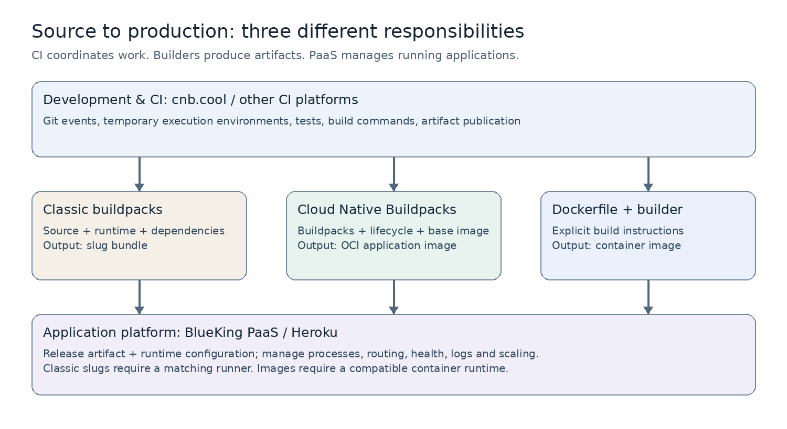
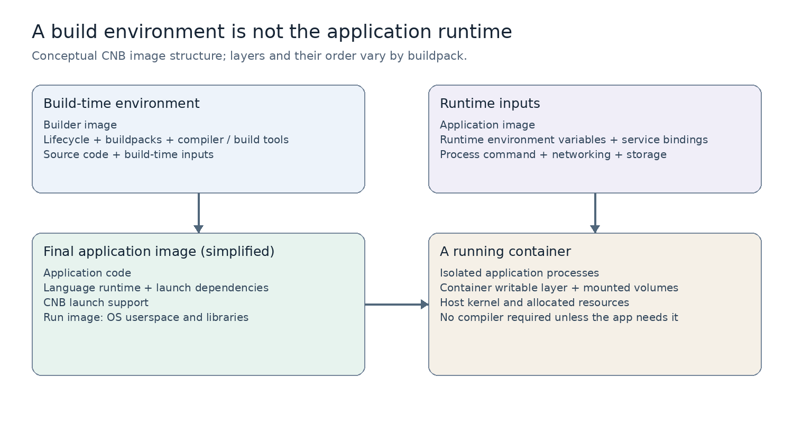

# 从源码到线上服务：读懂 CNB、Buildpack、Docker、Heroku 与蓝鲸 PaaS

你会使用 Kubernetes、会看 Pod，也知道 Python 依赖如何安装，却仍然觉得这些名词没有连起来，这很正常：它们横跨构建、打包、交付、运行四个阶段，而且相同单词在不同项目里还有不同含义。

本文用一个 Python/Django 应用串起它们。核心问题只有三个：**谁把源码变成产物，产物是什么，谁负责让它持续运行？**

资料核对日期为 2026 年 10 月 30 日。蓝鲸代码以公开仓库提交 `dde8617cf8d16551bf977fa480d230e78f02473d` 为观察点；它是开发分支快照，不能代表所有已发布版本，更不能据此判断某个私有部署的实际配置。文中代码是解释机制的示例，没有实际执行应用构建。个人评价和未来预测另作标识。

## 一、先用一张地图找到每个名词

| 名词 | 属于什么 | 主要职责 | 不应混同的概念 |
| --- | --- | --- | --- |
| Heroku | 应用 PaaS 产品 | 接收应用、构建、发布、运行和管理 | 一个 buildpack |
| 蓝鲸 PaaS | 应用平台及配套服务体系 | 管理 SaaS 生命周期，接入企业服务 | 只有镜像构建的工具 |
| cnb.cool | Cloud Native Build，云端研发平台 | 代码托管、云端开发、CI/CD、制品管理 | Cloud Native Buildpacks 项目 |
| buildpack | 构建组件这一类技术 | 根据语言和项目约定加工源码 | 特定版本的 CNB 规范 |
| Cloud Native Buildpacks | 规范及工具生态，简称 CNB | 将源码和依赖组织成 OCI 镜像 | 腾讯 cnb.cool 平台 |
| Docker | 容器工具与生态 | 镜像构建、分发与容器运行等 | Dockerfile，或所有容器技术的总称 |
| Kubernetes | 容器编排系统 | 调度、维护期望副本、连接服务等 | 自动理解并编译源码的构建系统 |

名称依据见 cnb.cool 官方首页、Buildpacks 官方概念文档及蓝鲸官方仓库。[1][2][3]



图 1：本文自绘概念图，依据 [2][3][4][5]。上层协调任务，中间构建产物，下层运行应用；这是组合方式示意，并非声称 cnb.cool 与蓝鲸已有默认集成。经典 slug 路线需要配套 runner，不能把 slug 当通用镜像直接运行。

最常见的分类错误，是拿 Docker 与 Heroku 比，或者拿 cnb.cool 与 buildpack 比。这就像拿编译器与应用商店比：它们可能合作，但职责不同。

## 二、从一个 Django 应用出发：上线到底缺什么？

假设仓库里有 `manage.py`、`mysite/wsgi.py`、`requirements.txt`，并计划运行 Gunicorn。

源码之外，你还需要确定：Python 版本、系统动态库、Python 包、启动命令、数据库连接、网络入口、运行副本数，以及失败后如何恢复。把这些事情拆开看：

| 阶段 | 做什么 | Django 示例 |
| --- | --- | --- |
| 构建 Build | 把源码加工为可发布产物 | 安装依赖、编译扩展、必要时收集静态文件 |
| 发布 Release | 选择产物与运行配置形成一次部署版本 | 绑定镜像版本、配置和服务；安排发布前置任务 |
| 运行 Run | 启动并维护进程 | Gunicorn 接收 HTTP，Celery 执行后台任务 |
| 运维 Operate | 观察、调整和恢复 | 看日志、健康检查、扩缩容、回滚 |

这四步不一定对应四个独立产品，但概念上要分开。**依赖安装成功，只说明构建的一部分成功；容器启动成功，也不意味着网络入口和业务健康已经正常。**

Heroku 用 build、release、run 来组织应用生命周期，发布版本把构建产物与配置等信息组合起来。[4] 蓝鲸也有准备、构建、发布及结果检测等步骤，后文会对照源码。[15]

## 三、Heroku 与经典 buildpack：先有“交源码”的体验

### 3.1 PaaS 的承诺是什么？

PaaS 是 Platform as a Service，平台即服务。对应用开发者，它提供一组约定：提交代码、声明依赖和进程，剩下的重复工作交给平台。

Heroku 是这一模式的重要代表。`git push` 只是提交与触发部署的一种入口，背后仍然有构建、产物存储、配置管理、进程调度和路由。[4]

例如 Procfile 可以写：

```procfile
web: gunicorn mysite.wsgi:application --bind 0.0.0.0:$PORT
worker: celery -A mysite worker
```

它表达两个进程类型及启动命令。Procfile 本身不安装 Python，不创建数据库，也不直接决定副本数；平台读取这些声明，再决定运行哪些进程。这里 `$PORT` 是采用此约定的平台注入的端口，不能假定所有平台都完全相同。

在 Heroku 中，运行应用的实例称为 dyno。它是平台的运行抽象，理解时可先把它视作运行应用命令的隔离实例，不必硬套成某一种固定的 Kubernetes 对象。[4]

### 3.2 Buildpack 实际做了什么？

平台如何知道 Python 应用该怎样构建？Heroku 将这些语言知识放进 buildpack。

经典 Buildpack API 主要有三个入口：[6]

| 入口 | 职责 | Python 场景 |
| --- | --- | --- |
| `bin/detect` | 判断是否适用 | 识别依赖文件等特征 |
| `bin/compile` | 加工应用目录 | 准备运行时、安装依赖、执行构建 |
| `bin/release` | 返回运行相关元数据 | 提供默认进程等信息 |

所以 buildpack 不是 Python 包管理器。它会调用 `pip`，如同 Node buildpack 会调用 npm；它处于更上一层，负责把语言工具组织成平台可用的流程。

“不用写构建脚本”实际上意味着：**你采用了别人维护的构建脚本及其约定。** 约定之外的需求仍需要配置、扩展，或换一种构建方式。

### 3.3 Slug 究竟是什么？

经典 Heroku 构建将加工后的应用目录打包成 slug，其中包含应用代码、语言运行时、依赖以及编译结果等。它需要平台配套的基础环境，不是包含独立内核的虚拟机，也不天然是标准 OCI 镜像。[4][6]

用一段描述记住这条链路：源码交给 buildpack 加工，平台打包为 slug，再把 slug 与配置交给运行环境，最后按 Procfile 启动进程。

这解释了为什么在某些 PaaS 里看不到 Dockerfile，应用依然能跑：**构建与运行环境的选择，已经被平台接管。**

## 四、Docker：把交付产物变成通用的镜像

### 4.1 镜像、容器和宿主机分别是什么？

镜像是静态的软件包，包含文件系统层及运行配置。容器是基于这些文件与配置启动的隔离进程。一个镜像可以启动多个容器实例；镜像不变，不代表实例中的临时文件也不能变化。[7][8]

对于常见 Linux 容器，进程共享宿主环境的 Linux 内核。镜像里的 Ubuntu、Debian 等主要指用户态文件与库，并非每个容器都启动一个独立内核。在 Windows 桌面运行 Linux 容器时，还要有提供 Linux 内核的环境；不能把“共享内核”误解为 Linux 进程直接使用 Windows 内核。

镜像可移植性也有边界：CPU 架构、操作系统、设备、内核能力和外部服务仍需兼容。一个带 CUDA 依赖的镜像不会凭空给机器提供 GPU。

### 4.2 Dockerfile 描述步骤，BuildKit 执行构建

下面只是讲解结构的 Dockerfile，假设依赖文件已包含 Django 与 Gunicorn，并提供 `.dockerignore` 排除不需要的文件：

```dockerfile
FROM python:3.12-slim
WORKDIR /app
COPY requirements.txt .
RUN pip install --no-cache-dir -r requirements.txt
COPY . .
CMD ["gunicorn", "mysite.wsgi:application", "--bind", "0.0.0.0:8000"]
```

这里角色不同：Dockerfile 是配方；Docker CLI/Buildx 接收构建请求；BuildKit 执行构建；输出是镜像。Docker 官方说明，现代 `docker build` 默认通过 Buildx 使用 BuildKit。[9]

先复制依赖文件、安装依赖，再复制代码，是为了在只改业务代码时尽量复用依赖安装缓存。缓存是否命中由构建输入及规则决定；`RUN pip install` 的缓存命中也不会自动探测远端包仓库是否出现新版本。[10]

实际生产还要按需加入非 root 用户、多阶段构建、基础镜像与依赖固定等措施。**“使用 Docker”只确定了一部分交付机制，不自动保证镜像小、安全、可重现。**

### 4.3 镜像为什么比 slug 更容易跨平台？

标准镜像除了文件内容，还描述层、配置与启动信息；Registry 提供分发机制。OCI 是 Open Container Initiative，相关规范帮助不同工具交换镜像与运行容器。

因此你可以用某种工具构建镜像，由另一种工具分发，再交给兼容运行时启动。Kubernetes 节点使用 containerd 等运行时，不要求安装 Docker Engine；dockershim 从 Kubernetes 1.24 移除，并不意味着 Docker 构建的镜像失效。[11]

**我的判断：Docker 的重要影响之一，是让“应用怎么打包”和“应用由哪家平台运行”更容易分开。** 但数据库、身份认证、网络与平台 API 仍可能造成迁移成本，镜像标准化不等于整个应用完全无绑定。

## 五、Cloud Native Buildpacks：保留源码体验，输出标准镜像

### 5.1 为什么还需要 CNB？

Dockerfile 给项目很大控制权，但一家企业有几百个相似的 Python 服务时，也可能有几百份相似配方。修基础镜像、统一依赖源、升级运行时，便成为分散维护工作。

Cloud Native Buildpacks 把语言构建经验组织成可组合的组件，再通过标准接口与平台协作，最终产出 OCI 镜像。[2]

历史顺序值得记住：2011 年 Heroku 提出 buildpack；2013 年 Docker 公开亮相；2018 年 Heroku 与 Pivotal 发起 Cloud Native Buildpacks 项目。[12][13] 所以“buildpack 比 Docker 早”成立，“Cloud Native Buildpacks 项目比 Docker 早”不成立。

### 5.2 六个角色，分别在做什么？

| 角色 | 是什么 | 你可以怎样理解 |
| --- | --- | --- |
| Buildpack | 探测和构建组件 | Python、Node、进程声明等专项能力 |
| Build image | 构建阶段的基础环境 | 可以提供构建所需的系统工具与库 |
| Builder image | 含 buildpacks、lifecycle、构建基础环境等的镜像 | 一套可分发的构建工具箱 |
| Run image | 应用运行的基础镜像 | 最终应用镜像的运行底座 |
| Lifecycle | 组织阶段、组装产物的程序 | 按 CNB 协议协调工作 |
| Platform / pack | 调用 lifecycle 并安排输入、环境与执行 | `pack` 是一种本地工具实现，PaaS 也可实现平台职责 |

Build image 与 builder image 经常被当成同一个词。Builder 还包含构建组件、lifecycle 等，并关联运行镜像。[2]

下面是命令形状示意，`<builder-image>` 必须替换为适合项目且可信的实际 builder：

```bash
pack build my-django-app --builder <builder-image>
```

不需要 Dockerfile，不代表不用容器技术。`pack` 通常利用本地容器环境组织构建；PaaS 可以用其他方式调用 lifecycle。CNB 产物也不要求以后只能由 `pack` 运行。

### 5.3 生命周期各阶段发生什么？

常见现代 CNB 构建流程可以这样理解；旧 API 和平台封装的显示顺序可能不同：[14]

| 阶段 | 解决的问题 |
| --- | --- |
| Analyze | 检查已有镜像信息及相关访问条件，为复用做准备 |
| Detect | 选择能够协作的一组 buildpacks，形成构建计划 |
| Restore | 恢复缓存层及元数据 |
| Build | 调用 buildpacks，准备语言运行时、依赖和应用产物 |
| Export | 将所需层与运行镜像组合，输出镜像并保存缓存信息 |

经典 API 的 `detect/compile/release` 与 CNB 的 `detect/build`、元数据及 lifecycle 机制不同。**不能把经典 buildpack 仓库直接当作原生 CNB buildpack 使用；迁移或兼容通常需要适配。**

### 5.4 构建镜像不是最终应用镜像



图 2：本文自绘，依据 [2][7][8][14]。最终层内容及顺序依具体实现而定；示意图不表示所有构建工具都会自动排除。

例如构建 Python 扩展时需要编译器，但应用运行可能只需要编译后的扩展与系统动态库。CNB 通过层及其用途等元数据区分构建与启动需要的内容，避免简单地把整个 builder 作为最终运行环境。[18]

Dockerfile 的多阶段构建也能做到类似分离。CNB 的优势在于把这套知识放进可复用组件，而不是只有 CNB 才能产生干净镜像。

### 5.5 Rebase、SBOM 与可重现性有什么价值？

**Rebase** 可以在兼容条件满足时，为已有应用镜像替换运行基础层，避免完整重建应用。[16] 例如运行基础镜像修补某个系统库，而应用层不需要改变。

但它不会修补所有漏洞：如果有问题的 Python 包或 Python 解释器位于 buildpack 生成的应用上层，通常仍需更新依赖或运行时并重新构建。跨越不兼容的系统底座也不能随意换层，更新后的镜像需要重新验证和发布。

**SBOM** 是软件物料清单，用于描述产物中有哪些软件组件；实际覆盖程度取决于 buildpack 和工具实现。[18] 它支持漏洞识别和追踪，不代表镜像没有漏洞。

**可重现构建** 的目标是相同输入产生相同输出，CNB 工具对相关元数据提供约束。[17] 但如果输入包含可变 tag、未锁定依赖、外部下载脚本或时间敏感行为，实际构建仍可能漂移。

**我的判断：对平台团队，CNB 最有价值的地方是构建知识、元数据与维护动作能够统一管理；省掉 Dockerfile 只是开发者最先看到的结果。**

## 六、cnb.cool：它负责组织工作，不等同于一种镜像算法

腾讯的 cnb.cool 名称是 Cloud Native Build，涵盖代码托管、云原生开发、云原生构建和制品库等能力。[1] 它与 Cloud Native Buildpacks 共享缩写，但职责不同。

比如一个简单流水线：

```yaml
main:
  push:
    - docker:
        image: python:3.12
      stages:
        - name: test
          script:
            - pip install -r requirements.txt
            - python manage.py test
```

这表示往 main 推代码后，在指定镜像提供的环境中执行脚本。该例假设 Django 测试配置及依赖已就绪，不包含应用镜像构建或部署。

官方文档将 `docker.image` 定义为流水线任务的运行环境；还支持通过 Dockerfile 动态构建这个环境。[5] 因此有两个独立问题：

1. **任务在哪里执行？** 例如在 `python:3.12` 容器里。
2. **任务生成什么？** 可能只是测试报告，也可能是 wheel、前端文件或应用镜像。

在流水线里运行容器，并不会自动产生新的应用镜像。同样，为流水线构建的工具镜像也不一定是交付给生产的镜像。

它的云原生开发则复用流水线机制，增加 IDE 服务等能力；官方说明两者都由 `.cnb.yml` 配置与构建引擎调度。[19] 一个供人写代码、调试的工作区，与长期承载线上流量的应用服务，生命周期和保障目标不同。

可以在 cnb.cool 的流水线内调用 Dockerfile 构建工具，也可以在配置好相应工具、容器能力和凭证后调用 CNB；再把产物交给蓝鲸等系统部署。**这是一种可设计的组合，不能假设平台默认已经完成集成。**

## 七、蓝鲸 PaaS：用源码看清 slug、CNB 与 Dockerfile 三条路

### 7.1 先划清“蓝鲸”与“开发者中心”的范围

蓝鲸官方仓库说明，`blueking-paas` 是 PaaS 的开发者中心项目，API 网关、统一登录、蓝鲸桌面分别有其他仓库。开发者中心包含后端 API、应用 Operator、前端以及数据库、对象存储等增强服务相关组件。[3]

因此“蓝鲸 PaaS 用了 buildpack”只描述其构建能力之一；它还需要处理应用模型、配置、服务绑定、部署、日志与生命周期管理。

另外，**蓝鲸的云原生应用类别、CNB 构建方式和 cnb.cool 产品，属于三个不同概念。** 云原生应用也可以采用 Dockerfile 或已有镜像等交付方式。

### 7.2 最值得读的函数：generate_builder_env_vars

在本次观察的代码快照中，`bg_build/utils.py` 的 `generate_builder_env_vars()` 明确分为三个分支：[20]

| 分支条件 | 源码注释与行为 | 关键环境变量 |
| --- | --- | --- |
| `metadata.use_dockerfile` | 按 Dockerfile 构建应用镜像 | `SOURCE_GET_URL`、`OUTPUT_IMAGE`、`CACHE_REPO` |
| `metadata.use_cnb` | 将应用构建为镜像 | `SOURCE_GET_URL`、`OUTPUT_IMAGE`、`CACHE_IMAGE`、`CNB_REGISTRY_AUTH` |
| 其他情况 | 将应用构建为 slug | `SLUG_SET_URL`、`CACHE_GET_URL`、`CACHE_SET_URL` 等 |

同文件的 `generate_launcher_env_vars()` 还生成指向 `slug.tgz` 的 `SLUG_GET_URL`。这给出了可观察的区别：**有的运行实例拿的是 slug 下载地址，有的拿的是构建完成的应用镜像。**

三个路线可分别理解为：

- 经典 slug：构建环境加工源码并上传 slug；配套 runner 获取产物并启动应用。
- CNB：构建环境调用 CNB 相关流程，输出应用镜像；部署侧运行该镜像。
- Dockerfile：构建器解释项目配方，输出应用镜像；后续部署同样围绕镜像进行。

仓库还单独定义已有镜像发布的步骤集，说明并非每次部署都必须在 PaaS 内现场构建。[15]

### 7.3 Slug-pilot、slugbuilder、slugrunner 怎么理解？

`sync_step_meta_set.py` 把 `slug-pilot` 与一组构建步骤绑定，并将名为 `blueking` 的 builder provider 绑定到该步骤集。[21] `bg_build/utils.py` 在 slug 分支中设置 `PILOT_BUILDER_TIMEOUT`。[20]

据此，**在这里应把 slug-pilot 理解为蓝鲸经典 slug 构建链路相关的组件或实现标识**。它不是 Cloud Native Buildpacks 规范中的标准角色，也不是 Heroku 平台本身。没有进一步核对具体组件源码及镜像版本前，不宜断言它的全部内部实现。

`slugbuilder`、`slugrunner` 则带有历史命名痕迹。初始化脚本在 `--type cnb` 配置中也使用 `--slugbuilder` 和 `--slugrunner` 参数，同时注入 `CNB_PLATFORM_API` 与 `CNB_RUN_IMAGE`。[22]

所以**不能只凭字段里有 slug 就认定走经典 slug 路线**。实际要结合类型、构建元数据、环境变量和产物判断。

### 7.4 为什么蓝鲸里会出现 Heroku？

源码中的 `PAAS_HEROKU_BUILDER_IMAGE`、`PAAS_HEROKU_RUNNER_IMAGE` 和 `heroku-24` 等配置，表明其构建与运行环境使用了 Heroku 相关技术、命名或兼容约定。[22]

这不等于“你的应用托管在 Heroku 公有云”。就像使用 PostgreSQL 不等于购买某一家数据库云服务，使用某种 buildpack 或基础镜像也不意味着部署去了其原作者的商业平台。

这里的 stack 名称也需要看上下文。经典 Heroku stack、CNB 不同年代的 stack/target 概念，以及蓝鲸数据库中的 stack 字段，并非永远完全相同。实际排查必须核对 builder、run image、buildpack 的兼容关系与版本。

### 7.5 对你最实用的解释：同一个平台里可能有三套 Python

| 环境 | Python 用途 | 是否等于应用运行版本 |
| --- | --- | --- |
| PaaS 控制面服务容器 | 执行开发者中心自己的 Django/Python 代码 | 不一定 |
| 构建 Pod / builder 容器 | 执行构建工具，下载或准备应用运行时 | 不一定 |
| SaaS 运行容器 | 执行应用的 Gunicorn、Celery 等 | 这才是需要确认的应用环境 |

而且同一个容器里还可能有系统 Python、虚拟环境 Python、buildpack 安装的 Python。`which python` 只说明当前 shell 的解析结果，不能证明已运行的 Gunicorn 就使用它。

可在**目标应用容器**中先检查：

```bash
command -v python
python -c 'import sys; print(sys.executable); print(sys.version); print(sys.path)'
python -m pip --version
```

这些命令的结论只适用于被调用的解释器。若要确认业务进程，应结合其启动命令、虚拟环境与进程信息；有条件时在应用进程内记录 `sys.executable`。使用 `python -m pip` 可以让 pip 与这次选定的 Python 对齐。

进一步要问：这个运行时是 Dockerfile 放进去的、CNB 某个层提供的，还是 slug 携带并由 runner 激活的？回答后，升级该改哪里也就清楚了。

## 八、把排障问题放回正确阶段

| 现象 | 先看哪里 | 常见原因 |
| --- | --- | --- |
| `pip install` 超时 | 构建 Pod 的日志与网络 | 包源、代理、DNS、认证 |
| 找不到编译器或头文件 | 构建基础环境与 buildpack | 缺编译工具或系统开发依赖 |
| 构建成功但运行时报缺 `.so` | 最终镜像或 slug 配套 runner | 构建时有库，运行时缺库；ABI 不匹配 |
| 包已安装但 `import` 失败 | 业务进程的解释器与 `sys.path` | pip 与 Python 不一致，或安装在另一环境 |
| 本地 Docker 能运行，平台失败 | 启动命令、用户、挂载与配置 | 平台覆盖入口、权限差异、配置缺失 |
| 环境变量在构建时存在，运行时消失 | 构建变量与运行变量的注入点 | 两个阶段没有自动继承关系 |
| 容器运行但访问失败 | 监听地址、端口、Service、Ingress | 只监听回环地址、端口不一致、路由配置 |
| 换了基础镜像仍有 Python 包漏洞 | 问题组件实际所在层 | 漏洞依赖位于应用层，需重新构建 |
| Pod 重建后文件丢了 | 临时层、卷与对象存储设计 | 数据仅写入临时文件系统 |

这些是诊断方向，不能代替具体日志。特别要避免“编译失败就改运行 Pod”“运行缺库就只给 builder 安装库”这类跨阶段修补。

我建议排查时固定记四个信息：**应用源码版本、builder 版本、运行产物 digest 或 slug 标识、运行配置版本。** 只说“代码没改”不能排除运行时、基础镜像或依赖输入变化。

## 九、我的技术判断：各自适合什么？

以下是基于上述机制的工程判断，不是平台官方结论。

### 9.1 Dockerfile 的灵活与 buildpack 的统一，都有代价

| 情况 | 我会优先考虑 | 原因与边界 |
| --- | --- | --- |
| 常规企业 Python/Java/Node 服务，数量多 | 平台维护的 CNB 构建路径 | 集中升级和规范更有价值，但需有人维护生态 |
| 特殊系统依赖、GPU、非典型编译链 | Dockerfile 或专门构建系统 | 显式控制更直接，需承担配方维护 |
| 已有稳定 CI 与镜像治理 | 直接交付镜像给 PaaS | 构建和运行职责清晰，仍需统一镜像契约 |
| 经典 slug 存量应用 | 按维护收益分批迁移 | 不应只为名称更新而重写，应评估兼容性与实际成本 |
| 个人小项目 | 当前最省维护的成熟路径 | 工具数量和排障成本通常比理论架构更重要 |

对平台团队，buildpack 的标准化是责任集中：默认 Python 版本、依赖源、缓存失效、基础库、安全修复、离线分发都需要持续维护。对开发者，Dockerfile 的自主权也是责任下放：能决定步骤，也需要理解其结果。

### 9.2 PaaS 的价值不在于把 Kubernetes YAML 换成网页

把一个 Deployment 变成按钮不难。难的是定义并维护“一个应用”应该具备什么：进程、配置、服务绑定、权限、域名、日志、健康、发布、回滚和资源预算。

在这个意义上，Heroku 的源码部署、蓝鲸的企业服务整合、cnb.cool 的开发与交付入口，分别解决了这条链中的不同摩擦。用户最终需要的是可预测的交付体验，而不是记住多少容器名词。

### 9.3 开放镜像降低绑定，但无法消除应用层绑定

CNB 让构建产物更容易跨运行平台，Dockerfile 也能做到。真正迁移应用时，往往还要处理数据库、认证、任务队列、对象存储及专有平台 API。

因此我更关心两个契约：一是**构建契约**，什么输入产生什么产物；二是**运行契约**，产物需要哪些配置、服务、端口和权限。把契约讲清楚，比只争论“有没有 Dockerfile”更能改善架构。

## 十、未来两到五年的走向：判断、依据与反例

以下是从 2026 年 10 月出发的预测，时间窗口约为 2028—2031 年。置信度是主观判断，不是统计概率，也不是对任何厂商路线的承诺。

### 预测一：OCI 继续作为交付共同语言，置信度高

**依据：** Docker、Kubernetes、CNB 已围绕兼容镜像和运行环境协作。[2][7][11] 这个交集使平台可以替换构建器，而不必同时替换全部部署能力。

**判断：** Dockerfile、buildpack、语言专用构建工具会长期并存，但在大量容器化服务中，最终交付物仍会收敛为标准镜像。平台之间会更重视 digest、签名、元数据和策略。

**失效条件：** 新工作负载广泛采用不同的封装与运行模型，或现有镜像难以满足隔离、启动与分发需求。即便如此，也更可能是多种形式并存，而非一次性替代。

### 预测二：CNB 的增长主要在平台内部，置信度中高

**依据：** CNB 面向平台与构建组件的接口、缓存、分层和 rebase 能力，适合集中维护。[2][14][16] 当前 Heroku 已区分经典与 CNB 路线，Fir 使用 CNB，Cedar 保留经典默认并可切换。[23]

**判断：** 更多开发者可能使用 CNB，却不直接运行 `pack`：他只会在平台选择语言版本并点击部署。企业平台比需要自由控制所有步骤的特殊项目，更可能体现其收益。

**失效条件：** builder 维护与兼容成本长期高于 Dockerfile 模板加自动化升级；或者团队语言太分散、平台规模太小，无法摊薄维护成本。

### 预测三：Dockerfile 不会很快消失，置信度高

**依据：** 现有工具对显式步骤、缓存和构建执行已有成熟支持。[9][10] 同时，不同项目的系统依赖与编译过程并不统一。

**判断：** AI 更容易生成和修改 Dockerfile，可能继续降低其入门成本；与此同时，企业会需要策略与模板约束生成结果。未来常见做法可能是：常规服务走标准构建路径，复杂项目保留显式配方。

**失效条件：** 出现覆盖绝大多数复杂工作负载、可解释且便于排障的更高层构建系统，显式配方才可能明显退居幕后。

### 预测四：AI 开发会增加对可销毁环境与可靠交付平台的需求，置信度中

**依据：** cnb.cool 已把开发工作区与流水线放在可声明、可调度的环境体系里。[19] 构建流程本身也能接受机器触发。

**判断：** 当 Agent 持续修改代码、跑测试、创建预览时，企业更需要隔离环境、受控凭证、可追踪产物和可恢复部署。AI 可能减少手写脚本，却增加环境创建与构建次数。PaaS 的标准路径会成为 Agent 的执行边界之一。

**失效条件：** AI 工作主要留在本地，云端环境成本过高，或企业无法开放足够权限。这个趋势也不意味着临时开发工作区自动变成生产托管服务。

### 预测五：蓝鲸的演进重点可能是统一应用契约与供应链，置信度中

**依据：** 本次代码快照中经典 slug、CNB、Dockerfile、已有镜像发布并存。[15][20] 这说明平台既要接纳不同交付来源，也要维护相似的部署和运行行为。

**判断：** 如果由我设计后续路线，我会优先统一产物记录、服务绑定、配置注入、运行诊断和升级策略，再逐步降低旧链路的维护负担。开发者应能清楚知道自己用了什么运行时、该怎样升级，而不必理解所有历史字段。

**不确定性：** 这是架构建议及方向推断，不是蓝鲸官方 roadmap。具体实施取决于存量应用、发布周期与维护团队优先级。不能据此推断 slug 路线何时退出。

## 十一、怎么把这些知识真正记住？

之后看到一个平台或构建工具，先回答四个问题：

1. 输入是源码、Dockerfile，还是现成镜像？
2. 在什么环境中构建，由谁维护构建规则？
3. 产物是 slug、目录、语言包，还是标准镜像？
4. 谁注入运行配置，启动进程，并持续维护服务？

对你的蓝鲸工作，再加一个问题：**现在看到的是平台控制面、构建容器，还是业务运行容器？**

建议按这条顺序学习和排查：先找一个已有 SaaS，确认构建路线与运行镜像；再在运行进程中核对 Python 与依赖位置；最后追溯它的 builder、buildpack 和基础镜像。这样每一个抽象名词，都能落到一个文件、一个配置或一段实际日志上。

## 来源与阅读顺序

以下均为本次查阅的官方文档、规范或官方项目源码。链接后的说明对应本文使用范围；在线文档后续可能变化。

1. [cnb.cool 官方文档首页](https://docs.cnb.cool/zh/)：Cloud Native Build 名称及产品范围。
2. [Cloud Native Buildpacks Concepts](https://buildpacks.io/docs/for-platform-operators/concepts/)：buildpack、builder、基础镜像、lifecycle、platform。
3. [蓝鲸 PaaS README](https://github.com/TencentBlueKing/blueking-paas/blob/dde8617cf8d16551bf977fa480d230e78f02473d/README.md)：开发者中心范围及组件。
4. [How Heroku Works](https://devcenter.heroku.com/articles/how-heroku-works)：应用、产物、进程、发布与运行模型。
5. [cnb.cool 构建环境](https://docs.cnb.cool/zh/build/build-env.html)：流水线环境及现有镜像、动态构建方式。
6. [Heroku Classic Buildpack API](https://devcenter.heroku.com/articles/buildpack-api)：detect、compile、release 与 slug。
7. [Docker：What is an image?](https://docs.docker.com/get-started/docker-concepts/the-basics/what-is-an-image/)：镜像文件、层与配置。
8. [Docker：What is a container?](https://docs.docker.com/get-started/docker-concepts/the-basics/what-is-a-container/)：容器进程与共享内核。
9. [Docker Build Overview](https://docs.docker.com/build/concepts/overview/)：Buildx 与 BuildKit。
10. [Docker Build cache invalidation](https://docs.docker.com/build/cache/invalidation/)：缓存匹配及失效。
11. [Kubernetes Container Runtimes](https://kubernetes.io/docs/setup/production-environment/container-runtimes/)：运行时与 dockershim 移除。
12. [Buildpacks History](https://buildpacks.io/history/)：2011 年起源、2018 年项目成立。
13. [Docker: Nine Years Young](https://www.docker.com/blog/docker-nine-years-young/)：2013 年公开演示。
14. [CNB Lifecycle](https://buildpacks.io/docs/for-platform-operators/concepts/lifecycle/) 与 [阶段说明](https://buildpacks.io/docs/for-buildpack-authors/concepts/lifecycle-phases/)：现代构建阶段与各组件职责。
15. [蓝鲸 step_meta_data.py](https://github.com/TencentBlueKing/blueking-paas/blob/dde8617cf8d16551bf977fa480d230e78f02473d/apiserver/paasng/paasng/platform/engine/phases_steps/step_meta_data.py)：slug、CNB、Dockerfile 和镜像发布步骤集。
16. [CNB Rebase](https://buildpacks.io/docs/for-app-developers/concepts/rebase/)：更换运行基础镜像层。
17. [CNB Build Reproducibility](https://buildpacks.io/docs/for-app-developers/concepts/reproducibility/)：可重现构建的目标与元数据。
18. [CNB Buildpack API 规范](https://github.com/buildpacks/spec/blob/main/buildpack.md)：层用途、进程和 SBOM 等接口。
19. [cnb.cool 云原生开发与构建的区别](https://docs.cnb.cool/zh/workspaces/workspace-vs-build.html)：相同引擎与不同环境用途。
20. [蓝鲸 bg_build/utils.py](https://github.com/TencentBlueKing/blueking-paas/blob/dde8617cf8d16551bf977fa480d230e78f02473d/apiserver/paasng/paasng/platform/engine/deploy/bg_build/utils.py)：三个构建分支、slug 地址和构建变量。
21. [蓝鲸 sync_step_meta_set.py](https://github.com/TencentBlueKing/blueking-paas/blob/dde8617cf8d16551bf977fa480d230e78f02473d/apiserver/paasng/paasng/platform/engine/management/commands/sync_step_meta_set.py)：slug-pilot 与 builder provider 的关联。
22. [蓝鲸 apiserver/init.sh](https://github.com/TencentBlueKing/blueking-paas/blob/dde8617cf8d16551bf977fa480d230e78f02473d/apiserver/init.sh)：基础镜像、buildpack、CNB 参数的初始化；不把描述字符串当作实际已安装版本的证据。
23. [Heroku Classic vs. Cloud Native Buildpacks](https://devcenter.heroku.com/articles/classic-vs-cloud-native-buildpacks)：当前代际与构建路线。

两张图为本文原创技术示意，使用程序绘制，图下注明了依据来源。图中英语标签用于避免跨阅读器字体缺失，中文含义由相邻正文和表格完整解释。
