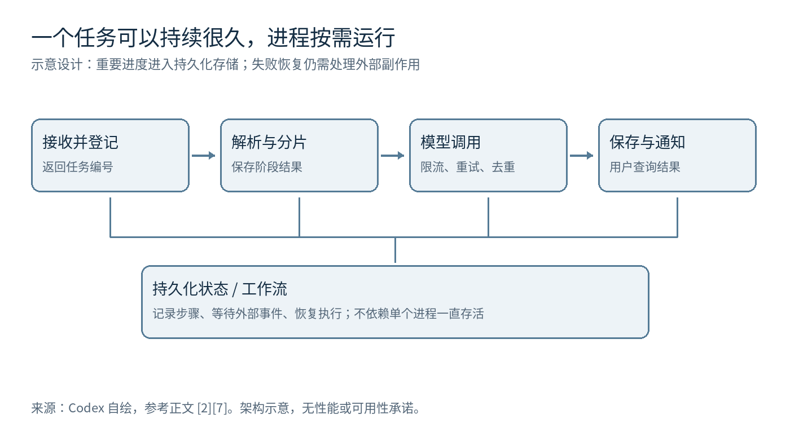
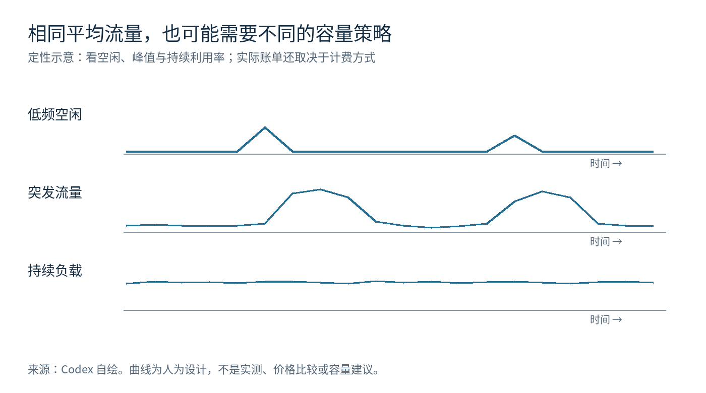

# Serverless 的下一站：云函数、容器与 AI 时代的计算方式

Serverless 的吸引力很直接：写好业务代码，让平台安排它运行。既然服务器管理可以外包，为什么我们仍然需要常驻服务、容器集群和专用计算资源？AI Agent 兴起后，这个答案会改变吗？

本文的判断是：**Serverless 会继续扩大适用范围，但其增长不能只用云函数调用量来理解。完整容器服务、有状态计算、持久化工作流和按需执行环境，都在承接同一种需求：让平台承担更多资源管理责任。** 云函数适合其中一部分业务；是否采用，应由负载、可靠性目标和总成本决定。

资料核对截至 2026 年 11 月 3 日。本文以 AWS、Google Cloud、Cloudflare 官方资料解释机制和产品方向，不能代表整个市场的采用率。全文业务案例为假设设计，成本数字为明确给定假设的演算，没有执行云端性能基准，也不预测市场规模。产品能力、地域、配额和价格可能变化，上线前应重新核对。

## 一、一个文档摘要服务，为什么会越来越复杂？

假设你做了一个产品：用户上传 PDF，系统调用模型生成摘要，再通知用户。最初可以用一个 HTTP 云函数完成全部步骤：接收文件、解析、调用模型、返回结果。

几位用户试用时，它工作得很好。后来有人上传几百页扫描件，OCR 比预想更慢；模型接口开始限流；浏览器连接中断，用户重复点击；模型已经完成并计费，函数却在保存结果前崩溃。

这时最困难的问题已经变成：任务是否被可靠接收？哪一步完成了？失败后从哪里恢复？用户重复提交是否重复付费？平台即使能自动启动更多函数，也无法凭空决定这些业务语义。

一个更可靠的设计通常是：上传接口只负责登记任务，文件进入对象存储，队列缓冲流量，后台执行解析与模型调用，数据库记录状态，用户查询结果。任务更复杂时，再用工作流组织步骤。

图 1：Codex 自绘的设计示意，参考 AWS 应用设计与 Cloudflare Workflows 文档。[2][7] 这是可选架构，不意味着每个小项目都需要部署全部组件。

这里的经验是：**Serverless 减少了服务器维护，却不会消除业务流程的复杂度。** 架构组件增加也不一定意味着方案变差；要比较的是，为相同可靠性目标，团队总共需要维护多少东西。

## 二、先把三个维度分开

此前文章已讨论 [CNB、Docker 与 PaaS](2026-10-30-cnb-buildpacks-blueking.md)。这里沿用其中“构建与运行分开”的框架，再增加执行和计费两个维度。

| 维度 | 需要回答的问题 | 可能的答案 |
| --- | --- | --- |
| 开发与交付 | 提交什么？怎样形成运行产物？ | 函数源码、完整应用、容器镜像；Dockerfile 或 Buildpacks 构建 |
| 执行与资源管理 | 谁启动实例、扩缩容、恢复执行？ | 自管服务、托管应用平台、按事件调度、持久化工作流 |
| 商业与计费 | 什么行为产生费用？ | 请求数、执行时长、资源占用、预留容量、存储与流量 |

PaaS 是提供应用开发和运行平台的服务模式；Serverless 更强调将底层资源分配和伸缩交给平台。两者有重叠，并没有所有厂商共同遵守的一条清晰分界线。云函数/FaaS 则是一种以函数为交付和执行单位的产品形态。[1]

一个应用可以通过 CNB 生成容器镜像，在 Serverless 容器平台上运行。Google Cloud 的 Buildpacks 文档就描述了源码到镜像、再到托管运行的组合。[3] **使用 Serverless 容器，仍然需要容器；用户只是减少了对宿主机与集群的管理。** 同时，Serverless 还有采用其他隔离机制的实现，不能把它定义成某一种底层技术。

“Serverless 必须缩容到零”“必须按每次请求收费”“只能运行短函数”都不足以概括现在的产品。评价具体服务时，应查看它的生命周期、计费和约束。

## 三、跟踪一次调用：方便从哪里来，边界又在哪里？

以经典事件函数为例，请求到达后，平台选择可用执行环境；如果需要新环境，就准备运行时、加载代码和依赖、执行初始化，然后才执行处理函数。环境可能被保留，以供后续调用复用，最后再被回收。AWS 的生命周期文档明确区分初始化和调用阶段。[4]

**冷启动影响的是部分请求的延迟，不能只看平均响应时间。** 一个需要偶尔加载大型依赖的服务，平均值可能不错，p99 却无法满足用户目标。p99 表示约 99% 请求的延迟不超过该值。评估时应同时观察首次调用、突发扩容、正常复用，以及不同地域的实际表现。

最小实例数或预配置并发可以降低部分初始化等待，但会引入容量费用。它们改善的是可用环境供给，不能保证网络、数据库和业务代码的端到端延迟。Cloud Run 也允许保留最小实例，而不是始终缩容到零。[5]

实例复用有性能价值：数据库客户端、SDK 和只读缓存可以复用。不过，业务正确性不能依赖“下一次请求还会落在这个实例”。任务进度、付款记录和重要结果应进入持久化存储。

扩容还有一个容易忽视的副作用：**计算层的弹性，可能放大下游系统的压力。** 假设每个实例持有十个数据库连接，瞬间启动一百个实例，就可能需要一千个连接。这个例子是算术示意，实际取决于连接池、请求并发和平台。最大实例数、并发上限、连接代理、队列和下游限流，需要一起设计。

Cloud Run 支持一个实例同时处理多个请求；因此，“每个请求必然新建一个容器”并不成立。并发提高可能减少实例开销，也可能造成资源争用，需要实际测量。[6]

最后是重复执行。事件源与调用方式不同，投递和重试语义也不同；不能假设业务操作恰好发生一次。AWS 的设计指南要求为可能重复收到的事件实现幂等。[2]

在摘要案例中，可以用“文档内容版本＋摘要配置＋用户授权范围”标识逻辑任务，并通过数据库唯一约束或条件更新争抢执行权。真正困难的窗口是：模型调用已成功，结果尚未提交就崩溃。若供应商支持幂等键，可将其纳入协议；否则需要记录调用状态、对账或接受受限重复成本。单靠一个去重字段，无法自动解决跨系统事务。

## 四、成本：先算负载，再看单价

按量付费的好处，是让账单更贴近某类用量；是否便宜，仍取决于计费口径和利用率。AWS 的事件函数计费涉及请求与执行时长，Cloud Run 则有请求式和实例式计费选项，不能用一条公式概括所有产品。[8][9]

可以先用一个简化模型理解经济性：

> 总成本 = 执行资源＋请求与入口＋存储和数据库＋网络＋日志与监控＋预留容量＋维护投入。

下面只算“执行资源”的数学关系。假设函数每次使用 1 GB 内存、计费运行 1 秒；为方便演算，假定资源单价为每 GB·秒 0.00002 美元。这是教学假设，不是任何厂商当前报价。一个月按 30 天计算。

| 月任务量 | 累计 GB·秒 | 假设计费下的执行成本 | 平均同时执行数 |
| --- | ---: | ---: | ---: |
| 1 万 | 1 万 | 0.20 美元 | 约 0.004 |
| 100 万 | 100 万 | 20 美元 | 约 0.386 |
| 1000 万 | 1000 万 | 200 美元 | 约 3.858 |

平均同时执行数 = 任务量 × 平均执行秒数 ÷ 月秒数。它描述执行重叠，不能直接解释为 CPU 核数：等待网络时，任务仍可能处于执行与计费状态。峰值并发也可能远高于平均值。

图 2：Codex 自绘的定性负载示意，不是流量实测或计费曲线。面积不代表真实账单。

三类负载应分别分析：

- **低频且长时间空闲**：按需执行通常能减少闲置计算资源，但周边数据库与网络服务可能主导账单。
- **突发且峰谷明显**：弹性和排队有价值；若为严格延迟预留大量容量，成本优势会缩小。伸缩速度和配额也要验证。
- **持续稳定高负载**：常驻服务可能通过高利用率和容量折扣降低单位成本；托管平台也可能有容量方案，不能预先认定谁胜出。

公平比较必须匹配完成任务数、p95/p99 延迟、失败率、可用性和恢复目标。拿单台低价虚拟机与多地域可靠服务比较，或者拿串行函数与高并发容器比较，都容易得到误导结论。

维护投入也需要可解释的估算。小团队少维护一套集群，可能比节省计算账单更重要；已有成熟平台的大团队，则未必有同样收益。把工程师工资任意摊成一个数字，同样不能证明总成本更低。

对于 AI 摘要服务，还应比较每个成功任务的模型 token、失败重试和重复执行费用。假设模型花费 0.02 美元，而函数执行花费 0.00002 美元，那么减少一次重复模型调用，远比微调一次函数时长有价值。这也是给定假设的比例说明。

## 五、为什么平台开始提供容器、状态与持久化执行？

平台演进反映了原有抽象遇到的业务需求，但功能发布本身不证明市场成功。

**完整容器服务，扩大了能够托管的应用范围。** Cloud Run 允许部署代码、函数或容器，开发者可以保留熟悉的 Web 框架和依赖。[10] 这减少了为了适配函数接口而改造应用的工作，不过仍需处理无状态副本、请求超时、关闭信号和后台任务生命周期。

**有状态计算，把部分协调问题放到平台内部。** Cloudflare Durable Objects 将特定对象的计算与持久化存储结合，可用于会话、实时协作和协调。[11] “有状态”并不意味着内存永久存在，也不消除热点、数据位置和一致性选择；仍要研究对象生命周期与数据模型。

**持久化工作流，把一次长业务拆成可恢复的步骤。** Cloudflare Workflows 提供步骤重试与状态持久化；AWS 的执行环境文档也已经讨论 Durable Functions 的状态与检查点能力。[7][4] 业务任务可以持续很久，执行进程则在等待时退出，之后按保存的状态恢复。

但恢复机制不能保证所有外部副作用只发生一次。工作流升级后的历史兼容、步骤输出保留、失败补偿、人工干预和审计，都会成为新的平台使用成本。

**容量与硬件选择，回应稳定负载的经济性要求。** Lambda Managed Instances 将函数执行与 EC2 实例选择、容量经济性结合，由平台处理基础设施生命周期。[12] 这支持了一个观察：Serverless 的产品范围正在扩大，其运维体验可以与更多资源配置方式结合。它是否适合某个 API，还要实测伸缩、并发、故障恢复和总价。

这些路线的共同难题是：平台承担更多责任后，开发者能否理解它的行为，并在故障时有效介入？一个难以观察和恢复的平台，可能节省了部署时间，却增加了事故成本。

## 六、AI 的机会：分清应用、Agent 与模型计算

第一层是调用模型的应用。鉴权、Webhook、检索请求、任务登记和结果处理，往往符合按请求或事件执行的模式。但长时间等模型返回时，不同平台对墙钟时长、CPU 时间和内存占用的计费差异，会直接影响成本。

第二层是 Agent 的协调与执行。一个 Agent 可能调用工具、等待远端任务、要求人工确认，然后继续工作。持久化执行很适合记录这段过程；按需隔离环境适合运行工具与生成的代码。Cloudflare 已有将模型调用和工具调用作为可重试步骤的官方示例。[13]

这不代表整个 Agent 都适合塞进一个函数。状态机、权限、工具沙箱和模型调用可能属于不同执行单元。执行不可信代码时，尤其需要验证隔离边界、网络权限、资源限额及环境清理；“已经在云上”不是充分条件。

第三层是模型推理与训练。推理的模型加载时间、显存占用、批处理效率，以及训练的通信需求，与轻量 API 很不一样。Cloud Run 已提供 GPU 服务支持，因此“Serverless 无法承载 GPU”已不是普遍有效的说法。[14] 真正的问题是冷模型与热模型的延迟、吞吐和每 token 成本如何取舍。

如果模型常驻、请求稳定、批处理收益明显，预留 GPU 可能更合理；如果任务稀疏、模型易加载或平台能有效共享容量，按需 GPU 可能有吸引力。需要在相同模型、精度、输入输出长度、并发和延迟目标下比较，不能跨模型拿价格数字作结论。

**本文推断：AI 对 Serverless 最直接的推动，可能首先发生在应用编排、持久化任务和隔离工具执行层。** 模型计算层也有机会，但其竞争更多取决于资源利用率和调度效率。这个判断需要生产采用与单位任务成本来验证，不能只看平台是否发布了 Agent SDK。

## 七、未来三到五年，怎样检验前景？

我们没有足够一致、独立的数据，断言 Serverless 会占据后端市场多少份额。更可靠的做法是提出可以被证伪的判断。

| 判断 | 当前依据 | 应继续观察什么 | 会削弱判断的证据 |
| --- | --- | --- | --- |
| 函数与完整应用的托管体验继续融合 | Cloud Run 等已支持多种交付方式 | 跨负载部署与排障是否真正统一 | 迁移成本、运行限制持续迫使大量应用离开 |
| 持久化执行的重要性上升 | 平台已提供工作流、检查点与恢复 | 业务恢复成功率、调试和版本兼容 | 复杂度与绑定成本高于自建方案收益 |
| 稳定负载会获得更多容量选择 | 托管实例与多种计费方式出现 | 相同服务目标下的单位任务总成本 | 托管溢价长期超过运维节省 |
| AI 带来新的按需执行需求 | 长任务与工具调用可映射到现有能力 | 生产任务量、续用、可靠性与成本 | 模型平台包办编排，或常驻执行显著更合适 |
| 标准镜像改善交付迁移，状态迁移仍困难 | 镜像标准与专有运行服务并存 | 更换平台时要改多少业务接口和数据 | 状态、权限与工作流出现广泛可互操作标准 |

相较于“函数是否取代服务器”，更值得关注的是谁拥有执行的控制权、谁承担闲置与故障成本，以及平台新增的抽象是否降低了整个系统的复杂度。

这一发展也有明确阻力。大型企业已有平台团队，核心服务可能需要持续吞吐和严格控制；数据地域、审计、私网依赖与服务配额，会限制可用方案。小产品增长后也可能迁出部分计算。局部迁移只能说明某类负载的取舍变化，不能单独证明整个模式兴衰。

## 八、落到自己的项目：先做什么？

| 项目特点 | 值得优先验证的方案 | 首先验证的风险 |
| --- | --- | --- |
| 低频 Webhook、事件处理、定时任务 | 云函数 | 重试、幂等、超时、周边固定成本 |
| 已有完整 Web 应用，需要减少集群维护 | Serverless 容器或托管 PaaS | 冷启动、并发、数据库连接、后台执行 |
| 多步骤、跨小时、等待人工确认 | 持久化工作流＋执行单元 | 副作用、恢复、版本兼容与审计 |
| 稳定高吞吐、严格延迟、特殊依赖 | 常驻服务与托管容量方案共同评估 | 利用率、冗余容量、运维与故障成本 |
| 模型推理 | 托管推理、按需 GPU 与预留 GPU 对比 | 模型加载、显存、批处理与单位 token 成本 |

这些方案可以组合。摘要产品的入口可能用云函数，解析用容器任务，模型由独立推理平台提供，工作流负责协调；也可能在早期用一个常驻服务和数据库就足够。

最有价值的小实验，是给同一个摘要任务实现两条执行路径：按需函数与常驻容器。在小流量、突发与持续负载下，测量成功任务数、端到端 p99、失败恢复时间、重复外部调用次数和每个成功任务的总成本。主动在“模型完成但结果尚未保存”的窗口制造失败，往往比只压测峰值 QPS 更能暴露架构问题。

学习上，HTTP、事件驱动、数据库事务、幂等、队列、可观测性和成本分析，比记住某个平台的所有配置更耐用。Serverless 的前景最终要由这些具体问题的解决程度来判断：**让开发者可靠地完成一项业务任务，需要投入多少资源、多少维护，以及多少对平台的依赖。**

## 来源与研究边界

以下均为实际查阅的官方资料。厂商文档适合核实产品机制，不能独立证明市场份额、客户总成本或行业趋势。正文趋势判断为作者分析。配图为原创机制示意，无第三方图片授权依赖。

1. [Google Cloud：What is PaaS?](https://cloud.google.com/learn/what-is-paas)
2. [AWS：Designing Lambda applications](https://docs.aws.amazon.com/lambda/latest/dg/concepts-application-design.html)
3. [Google Cloud：Buildpacks overview](https://docs.cloud.google.com/docs/buildpacks/overview)
4. [AWS：Execution environment lifecycle](https://docs.aws.amazon.com/lambda/latest/dg/lambda-runtime-environment.html)
5. [Google Cloud：Minimum instances](https://docs.cloud.google.com/run/docs/configuring/min-instances)
6. [Google Cloud：Maximum concurrent requests](https://docs.cloud.google.com/run/docs/about-concurrency)
7. [Cloudflare：Workflows overview](https://developers.cloudflare.com/workflows/)
8. [AWS：Lambda pricing](https://aws.amazon.com/lambda/pricing/)
9. [Google Cloud：Cloud Run pricing](https://cloud.google.com/run/pricing)
10. [Google Cloud：What is Cloud Run?](https://docs.cloud.google.com/run/docs/overview/what-is-cloud-run)
11. [Cloudflare：Durable Objects overview](https://developers.cloudflare.com/durable-objects/)
12. [AWS：Lambda Managed Instances](https://docs.aws.amazon.com/lambda/latest/dg/lambda-managed-instances.html)
13. [Cloudflare：Build a durable AI agent](https://developers.cloudflare.com/workflows/get-started/durable-agents/)
14. [Google Cloud：GPU support for services](https://docs.cloud.google.com/run/docs/configuring/services/gpu)
